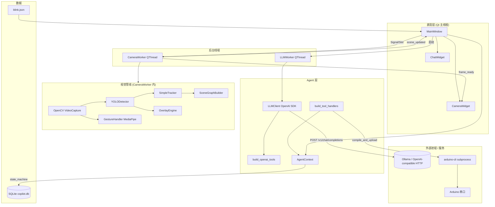
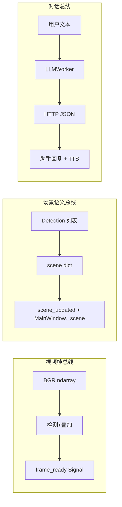
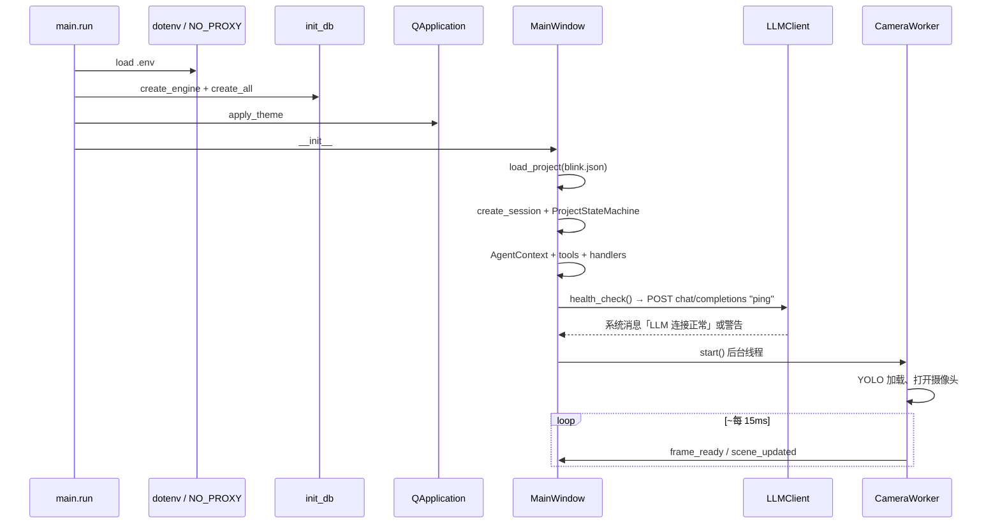
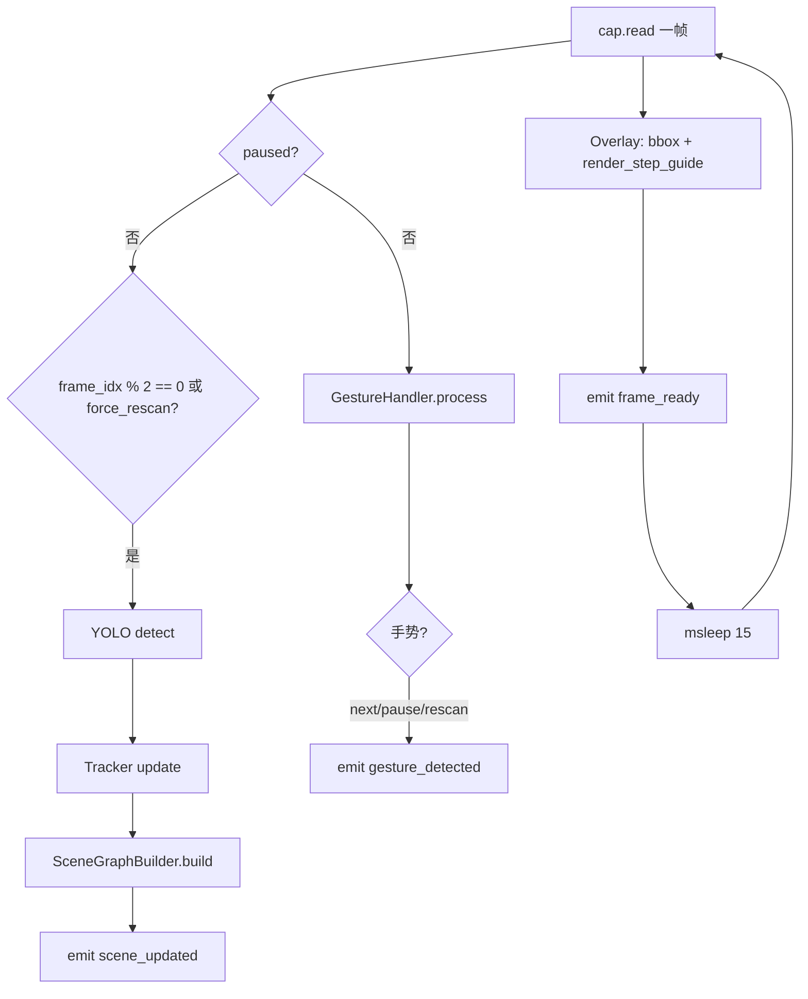
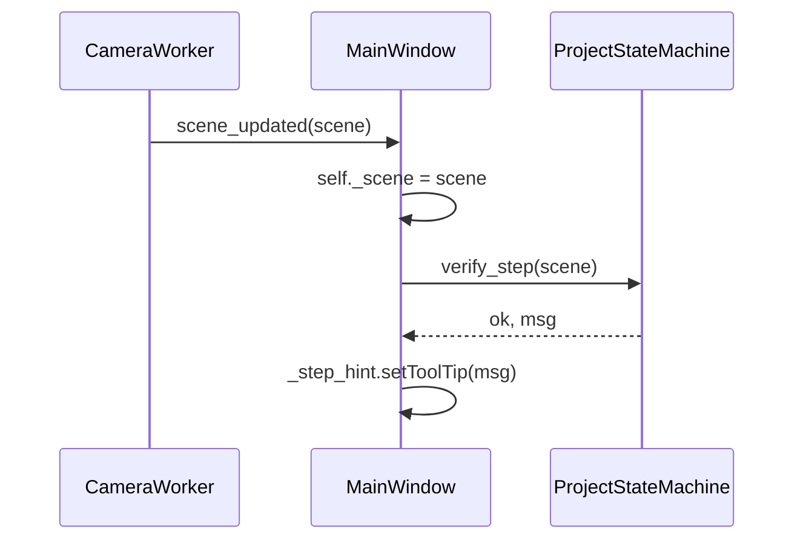
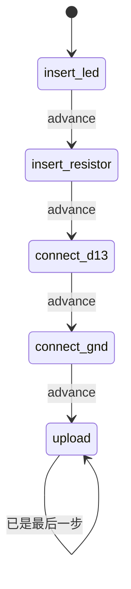
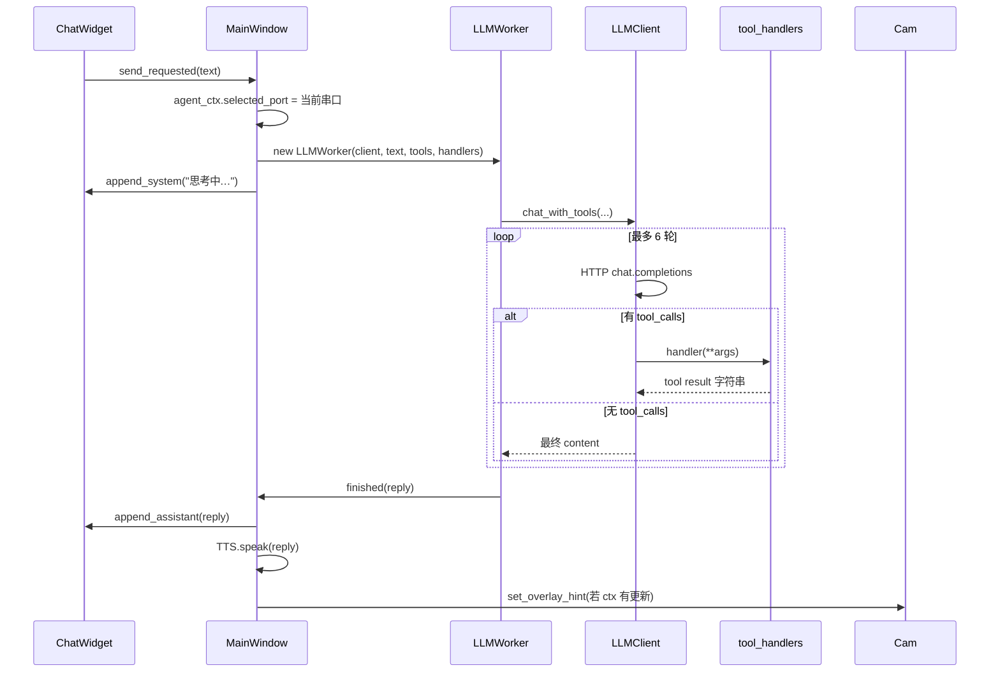
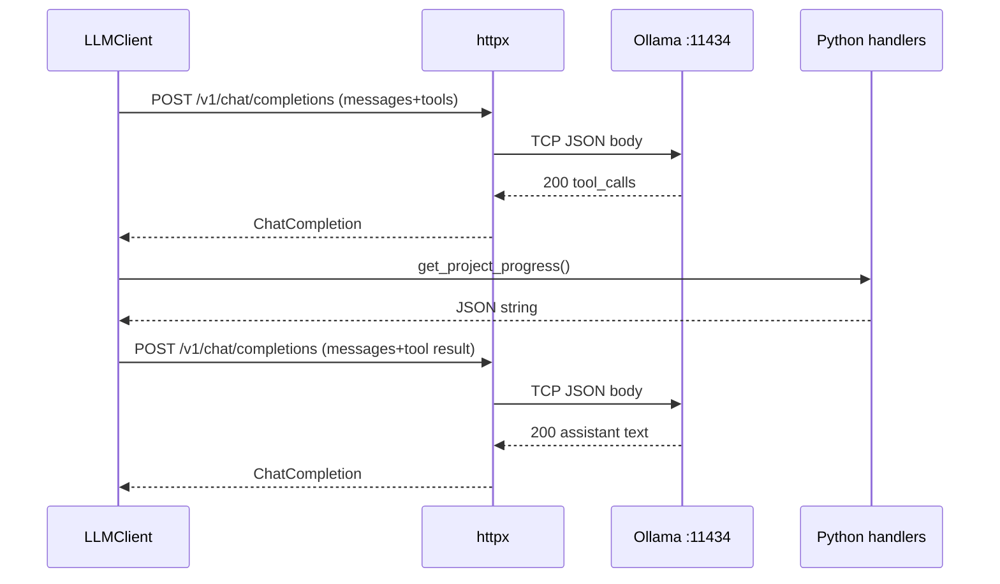
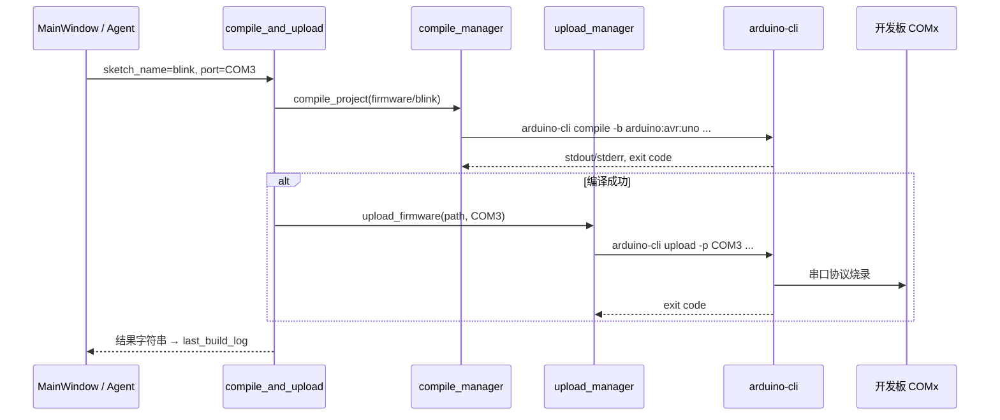

# Arduino AI Learning Copilot — 架构与交互说明

本文档描述当前 MVP 工程的**整体架构**、**运行时工作原理**、**模块间消息**，以及**向大模型后端发送一次聊天请求**时从 UI 到 HTTP 的完整路径（便于对照 Wireshark / Fiddler 抓包）。

> 图示使用 [Mermaid](https://mermaid.js.org/)。在 VS Code（Markdown Preview）、GitHub、Typora 等环境中可直接渲染为图形；也可将代码块复制到 [Mermaid Live Editor](https://mermaid.live) 导出 PNG/SVG。

---

## 1. 产品目标与能力边界

| 能力 | 实现方式 |
|------|----------|
| 桌面 GUI | PySide6（`MainWindow` + `ChatWidget` + `CameraWidget`） |
| 摄像头 + 检测框 | OpenCV 采集 + Ultralytics YOLO + `OverlayEngine` |
| 教学步骤 | JSON 项目定义（`config/projects/blink.json`）+ `ProjectStateMachine` |
| 步骤叠加引导 | 根据当前步骤的 `requires` / `pin` 在画面上画框、箭头 |
| 手势 | MediaPipe Hands → 赞/握拳/V 字 |
| 对话助教 | OpenAI 兼容 API（默认内网 Ollama）+ Function Calling |
| 烧录 | 子进程调用 `arduino-cli compile` / `upload` |
| 会话记录 | SQLite（`data/copilot.db`，步骤推进写入 `step_history`） |
| 语音（可选） | ASR：本地 faster-whisper 或远程 Ollama qwen3-asr；TTS：本机 pyttsx3/SAPI |
| 导师体验 | 多轮对话、步骤 hint 朗读、视觉校验主动提醒、`【朗读】` 口语段 |

**入口**：`python src/main.py` → 加载 `.env` → `init_db()` → `QApplication` → `MainWindow`。

---

## 2. 仓库目录（逻辑分层）

```text
ai_ardunio/
├── src/main.py                 # 进程入口、路径与 .env 引导
├── config/
│   ├── settings.py             # Pydantic Settings（读 .env）
│   └── projects/*.json         # 实验步骤定义
├── firmware/                   # Arduino 草图（blink、button_led）
├── models/best.pt              # 可选自训 YOLO 权重
├── data/copilot.db             # 运行时 SQLite
├── src/
│   ├── ui/                     # Qt 界面与线程 Worker
│   ├── agent/                  # LLM 客户端、工具定义、系统提示
│   ├── vision/                 # YOLO、跟踪、场景图
│   ├── overlay/                # OpenCV 绘制
│   ├── gesture/                # MediaPipe 手势
│   ├── project/                # 状态机、ORM、仓库
│   ├── arduino/                # CLI 封装、串口列表
│   └── voice/                  # ASR / TTS
└── docs/ARCHITECTURE.md        # 本文档
```

---

## 3. 系统架构总览

### 3.1 分层架构图



### 3.2 运行时三条“数据总线”



| 总线 | 载体 | 消费者 |
|------|------|--------|
| 视频帧 | `numpy.ndarray` (BGR) | `CameraWidget.show_frame` |
| 场景 | `dict`：`nodes` + `summary` | `ProjectStateMachine.verify_step`、Agent 工具 `get_scene_summary` |
| 对话 | `str` | `ChatWidget`、可选 `TextToSpeech` |

---

## 4. 启动序列（从 `main.py` 到首帧画面）



**关键对象生命周期**（在 `MainWindow.__init__` 中创建）：

- `ProjectStateMachine`：当前步骤索引、与 `verify_step` / `progress` 联动。
- `AgentContext`：持有状态机、`get_scene` 闭包、`selected_port`、`overlay_hint`、`last_build_log`。
- `CameraWorker`：独立线程，**不得**在 Worker 内直接操作 Qt 控件，仅通过 Signal 回主线程。

---

## 5. 视觉线程：单帧处理流水线

`CameraWorker.run()` 在循环中完成以下逻辑（简化）：



### 5.1 检测 → 场景图消息结构

**模块调用链**（同线程、函数调用，无网络）：

1. `YOLODetector.detect(frame)` → `list[Detection]`
2. `SimpleTracker.update(dets)` → 为每个框分配/保持 `track_id`（IoU 匹配）
3. `SceneGraphBuilder.build(dets)` → `dict`

**`scene_updated` 发出的 JSON 形态示例**（Agent 工具会 `json.dumps` 整包返回给模型）：

```json
{
  "nodes": {
    "led_1": {
      "type": "LED",
      "bbox": [120, 200, 180, 260],
      "confidence": 0.82,
      "connected_to": "jumperwire_2"
    },
    "jumperwire_2": {
      "type": "JumperWire",
      "bbox": [300, 210, 400, 230],
      "confidence": 0.71,
      "connected_to": "uno_d13_zone"
    }
  },
  "summary": {
    "LED": 1,
    "JumperWire": 2,
    "ArduinoUNO": 1
  }
}
```

`summary` 中的类型计数是 **`ProjectStateMachine.verify_step`** 判断是否“看到所需器件”的依据：`requires` 里每种类型在 `summary` 中计数 ≥ 1 即视为满足（启发式，非严格电气验证）。

### 5.2 主线程对场景的响应



叠加层提示来自当前步骤：`MainWindow._apply_overlay_from_step()` 把 `{hint, requires, pin}` 写入 `AgentContext.overlay_hint` 并 `CameraWorker.set_overlay_hint()`。`OverlayEngine.render_step_guide` 在检测到 `ArduinoUNO` 时按相对坐标高亮 D13/GND 区域并画箭头。

---

## 6. 教学步骤状态机（Blink 示例）

步骤定义见 `config/projects/blink.json`：

| 顺序 | step id | requires / action | 界面行为 |
|------|---------|-------------------|----------|
| 1 | insert_led | LED | 叠加提示插 LED |
| 2 | insert_resistor | Resistor | 电阻串联 |
| 3 | connect_d13 | JumperWire, pin D13 | UNO 上 D13 区域高亮 + 箭头 |
| 4 | connect_gnd | JumperWire, pin GND | GND 区域高亮 |
| 5 | upload | action=upload_sketch | verify 恒为 true，提示烧录 |

**推进步骤的三种方式**：

1. UI 按钮「下一步」→ `_advance_step()` → `state_machine.advance()` → 写 SQLite `step_history`。
2. 手势「赞」→ `gesture_detected("next")` → 同上。
3. 对话中模型调用工具 `get_next_instruction`（会更新 `overlay_hint`，**不会自动 advance 索引**；真正前进仍依赖 UI/手势或后续扩展）。



---

## 7. 对话与 Agent：模块间消息

### 7.1 UI → Agent 线程

用户点击「发送」或语音转写完成后：



### 7.2 注册给模型的工具（OpenAI Tools  schema）

| 工具名 | 处理器行为 | 典型返回 |
|--------|------------|----------|
| `get_scene_summary` | `json.dumps(ctx.get_scene())` | 完整 scene 字典 |
| `get_project_progress` | `state_machine.progress()` | 当前步骤、索引、已完成列表 |
| `get_next_instruction` | 读 `next_step` 或当前步，写 `overlay_hint` | hint / requires / pin |
| `compile_and_upload` | `compile_project` + `upload_firmware` | 成功或日志尾部 |
| `explain_last_error` | 返回 `last_build_log` 尾部 | 编译/烧录 stderr+stdout |

系统提示词：`src/agent/prompts.py` 中的 `SYSTEM_PROMPT`（中文助教规则）。

---

## 8. 大模型后端：单次请求的 HTTP 细节（抓包对照）

客户端使用 **`openai` Python SDK**（底层 **httpx**）。配置来自 `.env`：

- `OPENAI_BASE_URL` — 例如 `http://10.67.34.44:11434/v1`
- `OPENAI_API_KEY` — Ollama 场景常填 `ollama`（仅作 Bearer 占位）
- `OPENAI_MODEL` — 例如 `qwen3.8:27b`
- **`NO_PROXY=10.67.34.44`** — 访问 Ollama **直连**，不走 `HTTP_PROXY`（企业代理）
- `HTTP_PROXY` / `HTTPS_PROXY` — 影响 SDK 访问**其他**外网地址；内网 Ollama 依赖 `NO_PROXY` 排除

### 8.1 实际请求 URL 与方法

| 项目 | 值 |
|------|-----|
| 方法 | `POST` |
| URL | `{OPENAI_BASE_URL}/chat/completions` |
| 示例 | `http://10.67.34.44:11434/v1/chat/completions` |
| TLS | 上述为明文 HTTP；若改为 `https://...` 则抓包需解密或看应用日志 |

### 8.2 启动时健康检查（`LLMClient.health_check`）

**应用层消息**（`messages` 数组）：

```json
[
  { "role": "user", "content": "ping" }
]
```

**等价 HTTP 请求体**（`max_tokens: 8`）：

```http
POST /v1/chat/completions HTTP/1.1
Host: 10.67.34.44:11434
Authorization: Bearer ollama
Content-Type: application/json
Accept: application/json

{
  "model": "qwen3.8:27b",
  "messages": [
    { "role": "user", "content": "ping" }
  ],
  "max_tokens": 8
}
```

**典型成功响应**（Ollama OpenAI 兼容格式，字段可能随版本略有差异）：

```json
{
  "id": "chatcmpl-...",
  "object": "chat.completion",
  "created": 1710000000,
  "model": "qwen3.8:27b",
  "choices": [
    {
      "index": 0,
      "message": {
        "role": "assistant",
        "content": "pong"
      },
      "finish_reason": "stop"
    }
  ]
}
```

Wireshark 过滤示例：`ip.addr == 10.67.34.44 && tcp.port == 11434`，再 Follow HTTP Stream 查看 JSON。

### 8.3 用户发送一句聊天（第一轮，含 tools）

用户输入：`当前到哪一步？`

**`LLMClient.chat_with_tools` 构造的首轮 `messages`**：

```json
[
  {
    "role": "system",
    "content": "你是 Arduino 实验助教 Copilot。根据工具返回的视觉检测与项目进度回答用户，用简洁中文。\n\n规则：\n- 不要编造摄像头未检测到的器件。\n..."
  },
  {
    "role": "user",
    "content": "当前到哪一步？"
  }
]
```

**首轮 HTTP 请求体**（`tools` 为 `build_openai_tools()` 返回的 5 个 function；`tool_choice` 未指定时由服务端/模型默认）：

```json
{
  "model": "qwen3.8:27b",
  "messages": [ /* 见上 */ ],
  "tools": [
    {
      "type": "function",
      "function": {
        "name": "get_scene_summary",
        "description": "当前摄像头检测与 scene graph 摘要",
        "parameters": { "type": "object", "properties": {}, "additionalProperties": false }
      }
    },
    {
      "type": "function",
      "function": {
        "name": "get_project_progress",
        "description": "当前实验项目步骤进度",
        "parameters": { "type": "object", "properties": {}, "additionalProperties": false }
      }
    }
    /* ... get_next_instruction, compile_and_upload, explain_last_error ... */
  ]
}
```

### 8.4 工具调用第二轮（应用内 + 第二次 HTTP）

若模型返回 `tool_calls`（示例：调用 `get_project_progress`）：

**第一次 HTTP 响应片段**：

```json
{
  "choices": [{
    "message": {
      "role": "assistant",
      "content": "",
      "tool_calls": [{
        "id": "call_abc123",
        "type": "function",
        "function": {
          "name": "get_project_progress",
          "arguments": "{}"
        }
      }]
    },
    "finish_reason": "tool_calls"
  }]
}
```

**应用内处理**（`llm_client.py`，无网络）：

1. 将 assistant 消息（含 `tool_calls`）append 到 `messages`。
2. `handler = tool_handlers["get_project_progress"]` → 执行 `state_machine.progress()`。
3. append tool 消息：

```json
{
  "role": "tool",
  "tool_call_id": "call_abc123",
  "content": "{\"project_id\":\"blink\",\"title\":\"Blink LED\",\"current_step\":\"connect_d13\",\"current_hint\":\"Connect to D13\",\"completed_steps\":[\"insert_led\",\"insert_resistor\"],\"step_index\":2,\"total_steps\":5}"
}
```

**第二次 HTTP 请求**：同样的 `POST /v1/chat/completions`，`messages` 长度为 4（system + user + assistant + tool），通常仍带 `tools` 数组。

**最终响应**：`finish_reason: "stop"`，`message.content` 为面向用户的中文答复 → `LLMWorker.finished` → 界面展示并 TTS。



### 8.5 与代理共存时的抓包注意点

| 目标地址 | 预期路径 |
|----------|----------|
| `10.67.34.44:11434` | **直连**（`NO_PROXY` 匹配） |
| `pypi.org` 等 | 经 `10.158.100.9:8080` 代理（仅安装依赖时，非运行时聊天） |

若聊天仍走代理，检查环境变量是否在 `main.py` 的 `_load_env_early` 之前已加载，以及 `NO_PROXY` 是否包含 Ollama 主机 IP（无端口后缀）。

---

## 9. Arduino 烧录路径（UI 与 Agent 共用）



`list_boards()` 优先 `arduino-cli board list --format json`，失败则回退 `pyserial` 枚举 COM 口。

---

## 10. 手势与语音旁路

### 10.1 手势（每帧，CameraWorker 内）

| 手势 | `GestureCommand` | MainWindow 动作 |
|------|------------------|-----------------|
| 拇指竖起，四指握拳 | `next` | `_advance_step()` |
| 五指握拳 | `pause` | `set_paused(True)`，停止 YOLO/场景更新 |
| 食指+中指 V 字 | `rescan` | `set_paused(False)` + `request_rescan()` |

### 10.2 语音

**ASR**

1. 按住「按住说话」→ `sounddevice` 采集 PCM。
2. 松开 → `ASRWorker` 后台转写（本地 `WhisperASR` 或远程 `OllamaASR`）。
3. 转写文本触发 `_on_chat(..., voice_mode=True)`。

**TTS**

1. 菜单「语音 → 语音回复」开启后，`_on_llm_reply` 调用 `spoken_text_from_reply`；语音提问时优先朗读 `【朗读】` 段。
2. `create_tts()` → 本机 pyttsx3/SAPI（`TTS_VOICE`、`TTS_RATE`）；可「停止朗读」，按住 PTT 会 `stop()`。

**导师旁路**

- `build_extra_system` 注入步骤与视觉校验；`dialog_history` 保留最近 20 条。
- 步骤前进：朗读当前 `hint`；`verify_step` 失败且节流通过时主动 system 提示。

---

## 11. 线程与 Qt Signal 一览

| Signal | 发送方 | 接收方 | 载荷 |
|--------|--------|--------|------|
| `frame_ready` | CameraWorker | CameraWidget | `np.ndarray` BGR |
| `scene_updated` | CameraWorker | MainWindow | `dict` scene |
| `gesture_detected` | CameraWorker | MainWindow | `str` 命令名 |
| `status_message` | CameraWorker | ChatWidget | 系统提示字符串 |
| `send_requested` | ChatWidget | MainWindow | 用户消息 |
| `finished` / `failed` | LLMWorker | MainWindow | 回复或异常文本 |
| `finished` / `failed` | ASRWorker | MainWindow | 转写文本或异常 |

**原则**：耗时操作（摄像头循环、LLM HTTP、arduino-cli）不在 GUI 主线程执行，避免界面冻结。

---

## 12. 配置项速查

| 环境变量 | 作用 |
|----------|------|
| `OPENAI_BASE_URL` | OpenAI 兼容 API 根路径（含 `/v1`） |
| `OPENAI_MODEL` | `model` 字段 |
| `OPENAI_API_KEY` | Authorization Bearer |
| `NO_PROXY` / `no_proxy` | 内网 LLM 主机绕过代理 |
| `ARDUINO_FQBN` | 默认 `arduino:avr:uno` |
| `ARDUINO_CLI` | CLI 可执行文件路径 |
| `CAMERA_INDEX` | 默认摄像头索引 |
| `YOLO_MODEL_PATH` | 自定义权重；缺失则用 `yolov8n.pt` |
| `YOLO_DEVICE` | `gpu`（默认，Intel 核显）/ `npu` / `cpu` / `auto`。`auto` 优先 NPU，失败再改用核显，再不行用 CPU |
| `DATABASE_PATH` | SQLite 文件路径 |
| `ASR_BACKEND` | `local` / `remote` |
| `WHISPER_MODEL_SIZE` | 本地 ASR 模型规模 |
| `OLLAMA_ASR_MODEL` | 远程 Ollama ASR 模型 |
| `TTS_ENABLED` | 默认是否开启语音回复 |
| `TTS_VOICE` / `TTS_RATE` | 本机 TTS 音色与语速 |

---

## 13. 已知 MVP 限制（读代码时的预期）

1. **YOLO 类别**：未放置 `models/best.pt` 时使用 COCO `yolov8n`，`requires` 中的 `LED`、`ArduinoUNO` 等可能检测不到，步骤验证仅作演示。
2. **`get_detections_json`**：在 `AgentContext` 中目前固定返回 `[]`，场景信息以 `get_scene_summary` 为准。
3. **场景图连接关系**：`SceneGraphBuilder` 仅用像素距离启发式，非真实电路仿真。
4. **工具轮次**：`max_rounds=6`，复杂多步工具链可能触发上限提示。

---

## 14. 本地复现「单步聊天」的调试方式

不抓包也可在应用侧观察往返：

1. 设置 `HTTPX_LOG_LEVEL=debug` 或 OpenAI SDK 的 debug（若启用）观察请求日志。
2. 在 `LLMClient.chat_with_tools` 内临时打印 `messages`（注意勿提交含密钥的日志）。
3. 使用 curl 模拟（直连 Ollama，与 `health_check` 一致）：

```powershell
$env:NO_PROXY="10.67.34.44"
curl.exe -s http://10.67.34.44:11434/v1/chat/completions `
  -H "Content-Type: application/json" `
  -H "Authorization: Bearer ollama" `
  -d "{\"model\":\"qwen3.8:27b\",\"messages\":[{\"role\":\"user\",\"content\":\"ping\"}],\"max_tokens\":8}"
```

---

## 15. 相关源码索引

| 主题 | 文件 |
|------|------|
| 入口 | `src/main.py` |
| 主界面编排 | `src/ui/main_window.py` |
| 视觉线程 | `src/ui/camera_worker.py` |
| LLM + 工具循环 | `src/agent/llm_client.py`, `src/agent/tools.py` |
| 步骤机 | `src/project/state_machine.py`, `config/projects/blink.json` |
| 叠加 | `src/overlay/engine.py` |
| 配置 | `config/settings.py`, `.env` |

---

*文档版本：与仓库 MVP 同步；若你扩展了 Agent 工具或项目 JSON，请同步更新第 6、7 节表格。*
