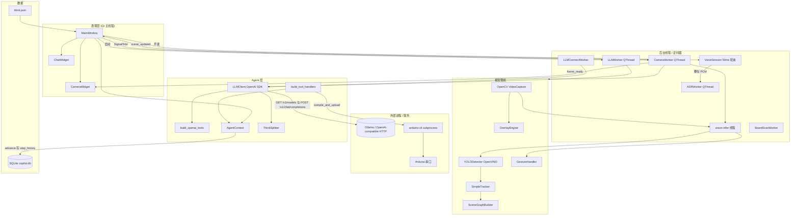
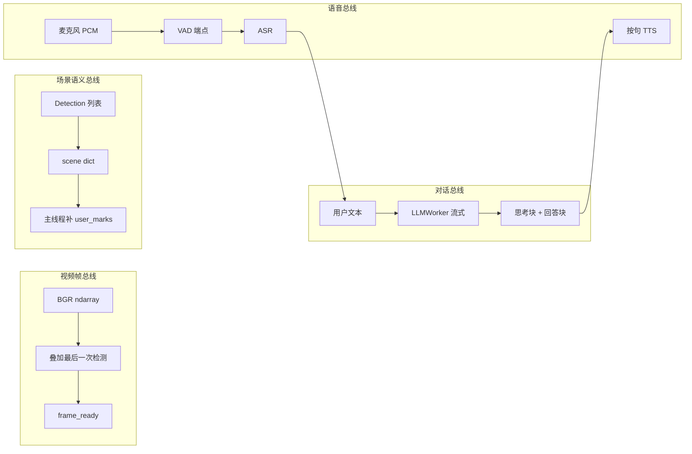
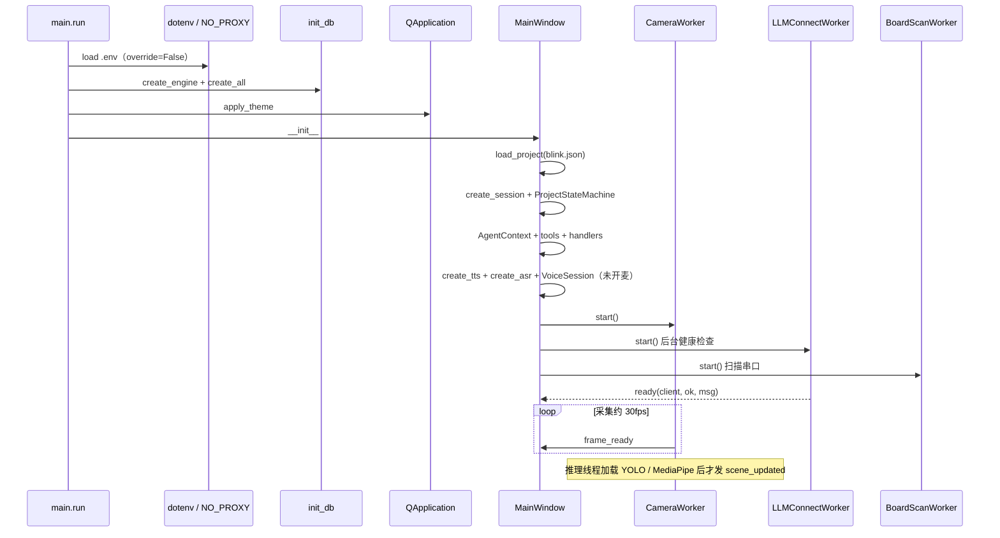
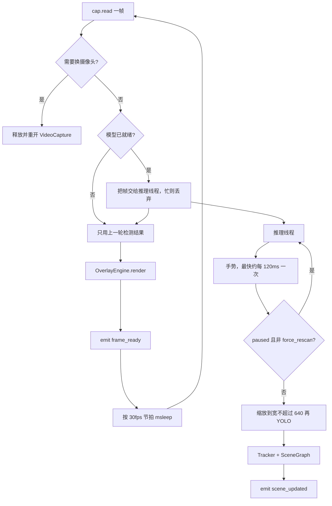
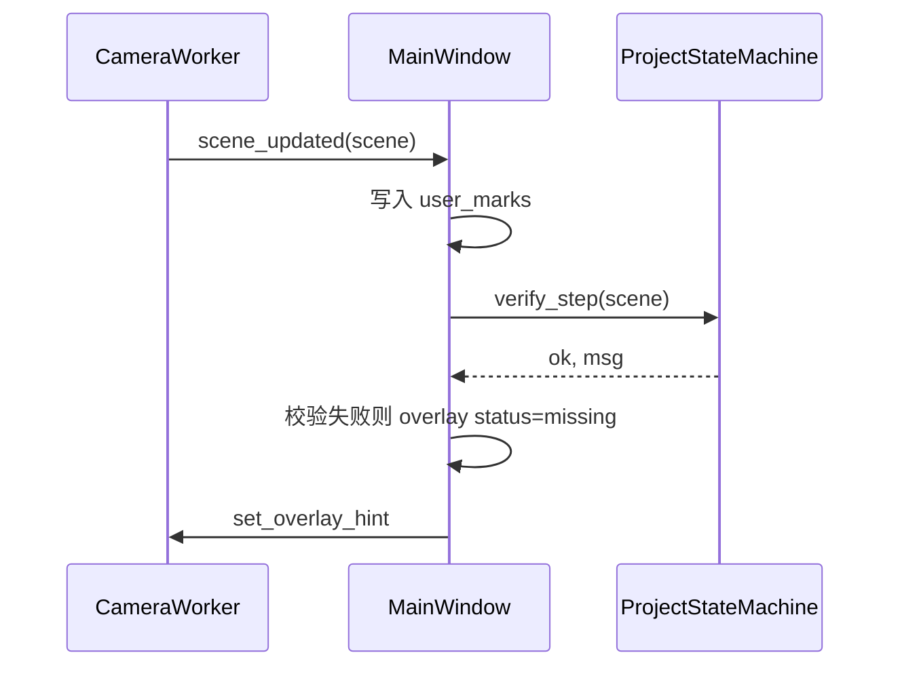
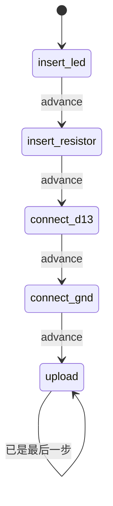
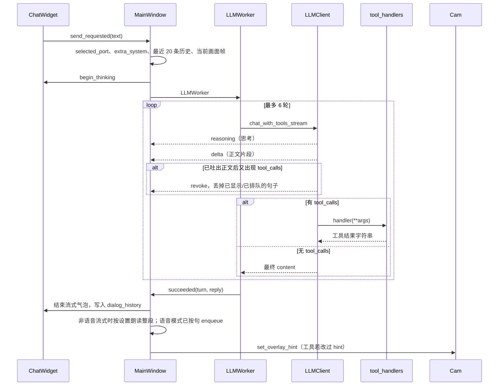
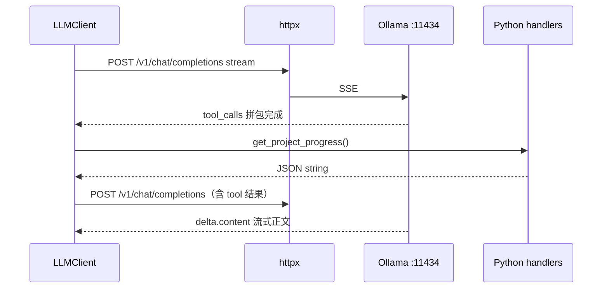
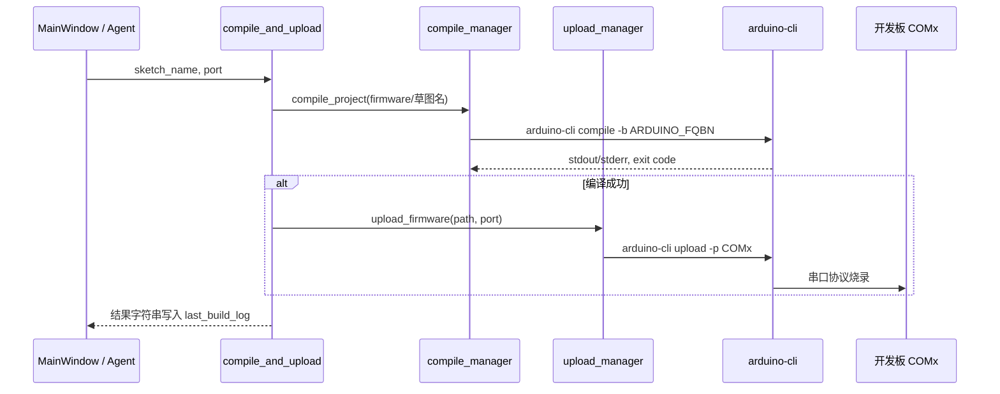
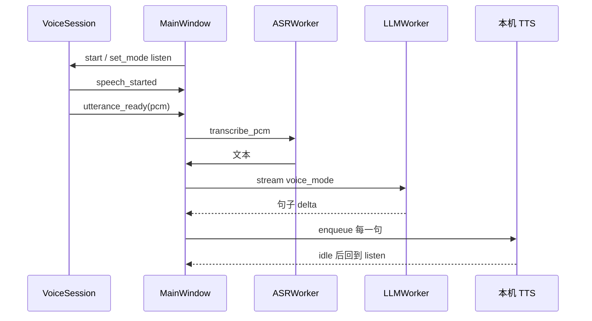

# Arduino AI Learning Copilot — 架构与交互说明

本文档描述当前工程的**整体架构**、**运行时工作原理**、**模块间消息**，以及**向大模型后端发送一次聊天请求**时从 UI 到 HTTP 的完整路径（便于对照 Wireshark / Fiddler 抓包）。

> 图示使用 [Mermaid](https://mermaid.js.org/)。在 VS Code（Markdown Preview）、GitHub、Typora 等环境中可直接渲染为图形；也可将代码块复制到 [Mermaid Live Editor](https://mermaid.live) 导出 PNG/SVG。

---

## 1. 产品目标与能力边界

| 能力 | 实现方式 |
|------|----------|
| 桌面 GUI | PySide6：顶栏菜单 + 摄像头工作区 + 右侧步骤/对话栏 |
| 摄像头 + 检测框 | OpenCV 采集（Windows 用 DirectShow）+ Ultralytics YOLO（默认 OpenVINO，Intel GPU/NPU） |
| 画面引导 | `OverlayEngine`：检测角标、步骤 HUD、引脚高亮、手部骨架、用户标记（单击点、矩形框、自由圈） |
| 教学步骤 | JSON 项目（启动时加载 `config/projects/blink.json`）+ `ProjectStateMachine` |
| 手势 | MediaPipe Hands → 赞 / 握拳 / V 字，经 `GestureDebouncer` 去抖 |
| 对话助教 | OpenAI 兼容 API（默认内网 Ollama）+ Function Calling + **流式**回复 |
| 看图 | 每次提问附一张当前画面（叠加图，长边 768，JPEG），模型不支持时自动不发 |
| 思考过程 | 模型 `reasoning` 字段或正文里的 `<think>` 块，单独显示，不送去朗读 |
| 烧录 | 子进程调用 `arduino-cli compile` / `upload`；日志面板默认隐藏 |
| 会话记录 | SQLite（`data/copilot.db`）：`sessions` + 步骤推进写入 `step_history` |
| 语音辅导 | 开麦 `VoiceSession`（能量 VAD）+ ASR + 按句 TTS；讲解中可打断 |
| 导师上下文 | `build_extra_system` 注入步骤、视觉校验、画面标记；对话记忆最近 20 条 |

**入口**：`python src/main.py` → 把仓库根目录和 `src/` 加入 `sys.path` → 加载 `.env` → `init_db()` → `QApplication` + `apply_theme` → `MainWindow`。

启动时**只加载 Blink**。`config/projects/button_led.json` 与 `firmware/button_led/` 已在仓库中，界面项目菜单目前没有切换项目。

---

## 2. 仓库目录（逻辑分层）

```text
ai_ardunio/
├── src/main.py                 # 进程入口、路径与 .env 引导
├── config/
│   ├── settings.py             # Pydantic Settings（读 .env）
│   └── projects/*.json         # 实验步骤定义（blink、button_led）
├── firmware/                   # Arduino 草图（blink、button_led）
├── models/best.pt              # 可选自训 YOLO 权重（缺失则用 yolov8n.pt）
├── yolov8n_openvino_model/     # 已导出的 OpenVINO 模型（可直接作为 YOLO_MODEL_PATH）
├── data/copilot.db             # 运行时 SQLite
├── tools/                      # 公开数据集下载、标签重映射、划分（训练侧，非运行时）
├── src/
│   ├── ui/                     # Qt 界面、主题、摄像头与后台 Worker
│   ├── agent/                  # LLM 客户端、工具、系统提示、思考流拆分、导师上下文
│   ├── vision/                 # YOLO、跟踪、场景图、类别别名、点击最近器件
│   ├── overlay/                # OpenCV 绘制与中文文字精灵
│   ├── gesture/                # MediaPipe 手势与去抖
│   ├── project/                # 状态机、ORM、会话仓库
│   ├── arduino/                # CLI 封装、串口列表、串口监视封装
│   └── voice/                  # 开麦会话、VAD、ASR、TTS、分句
└── docs/ARCHITECTURE.md        # 本文档
```

`src/arduino/serial_monitor.py` 封装了 `arduino-cli monitor`，**当前主界面没有接入**。编译/烧录输出只进可折叠的日志面板。

---

## 3. 系统架构总览

### 3.1 分层架构图



界面布局：左侧是摄像头卡片，其下是默认隐藏的「编译与烧录」日志；右侧是步骤标题、进度条和 `ChatWidget`。顶栏提供项目、硬件、摄像头、语音、视图五个菜单。系统菜单栏被隐藏。

### 3.2 运行时四条“数据总线”



| 总线 | 载体 | 消费者 |
|------|------|--------|
| 视频帧 | `numpy.ndarray` (BGR)，目标约 30 fps | `CameraWidget.show_frame` |
| 场景 | `dict`：`nodes`、`summary`、`frame`，主线程再加 `user_marks` | `verify_step`、导师上下文、工具 `get_scene_summary` |
| 对话 | 流式字符串（思考 / 正文分开） | `ChatWidget`、可选 TTS |
| 语音 | 16 kHz float32 PCM | `ASRWorker` → 与文字提问同一条 LLM 路径 |

采集和推理是分开的。采集线程每帧都画叠加并送 UI；推理线程忙时会丢掉新帧，画面继续用上一轮检测结果。

---

## 4. 启动序列（从 `main.py` 到首帧画面）



**关键对象生命周期**（在 `MainWindow.__init__` 中创建）：

- `ProjectStateMachine`：当前步骤索引；`advance()` 写 SQLite `step_history`。
- `AgentContext`：状态机、`get_scene`、`get_detections_json`、所选串口、`overlay_hint`、`last_build_log`。
- `CameraWorker`：QThread 只负责采集循环；YOLO 与手势在名为 `vision-infer` 的守护线程里跑。Worker **不得**直接改 Qt 控件，只通过 Signal 回主线程。
- `LLMClient` **不在**主线程构造。`LLMConnectWorker` 后台做健康检查，成功后把客户端交给主窗口。
- 后台 `QThread` 由 `_keep_alive` 持有引用，避免窗口关闭时线程仍在跑就被 Qt 销毁。

`get_detections_json()` 从当前场景节点抽出 `type` / `bbox` / `confidence`。它挂在上下文上，**没有单独注册成模型工具**；模型看到的场景走 `get_scene_summary` 和系统提示里的视觉摘要。

---

## 5. 视觉线程：采集与推理分离

`CameraWorker.run()` 打开摄像头（请求 1280×720、缓冲 1 帧）后启动推理线程，自己进入采集循环。



推理输入宽超过 640 时先缩小，检测框再按比例映回原图。手势也用同一张缩小图。

### 5.1 检测 → 场景图消息结构

**模块调用链**（推理线程内，无网络）：

1. `YOLODetector.detect(frame)` → `list[Detection]`（`conf=0.35`，类别名经 `normalize_class_name`）
2. `SimpleTracker.update(dets)` → IoU 匹配，保持 `track_id`
3. `SceneGraphBuilder.build(tracked)` → `dict`，并附上 `frame.width` / `frame.height`

**`scene_updated` 发出后，主线程还会写入 `user_marks`。** Agent 工具 `json.dumps` 的是主线程这份场景：

```json
{
  "nodes": {
    "led_1": {
      "type": "LED",
      "bbox": [120, 200, 180, 260],
      "confidence": 0.82,
      "connected_to": "jumperwire_2"
    },
    "jumperwire_2": {
      "type": "JumperWire",
      "bbox": [300, 210, 400, 230],
      "confidence": 0.71,
      "connected_to": "uno_d13_zone"
    }
  },
  "summary": {
    "LED": 1,
    "JumperWire": 2,
    "ArduinoUNO": 1
  },
  "frame": { "width": 1280, "height": 720 },
  "user_marks": [
    { "label": "标记 1", "kind": "point", "nx": 0.42, "ny": 0.55 },
    { "label": "标记 2", "kind": "box", "nx": 0.3, "ny": 0.4, "box": [0.2, 0.3, 0.4, 0.5] },
    { "label": "标记 3", "kind": "lasso", "nx": 0.7, "ny": 0.6, "box": [0.6, 0.5, 0.8, 0.7],
      "points": [[0.6, 0.5], [0.8, 0.52], [0.75, 0.7]] }
  ]
}
```

规范类别（`vision/component_db.py`）：`ArduinoUNO`、`Breadboard`、`LED`、`Resistor`、`JumperWire`、`Button`。数据集里的 `uno`、`jumper`、`push_button` 等别名会归一到这些名字。

`summary` 的类型计数是 **`verify_step`** 的依据：`requires` 里每种类型计数 ≥ 1 即视为出现。步骤 JSON 里的 `spatial` 会被读入，**校验不用它**。`action=upload_sketch` 的步骤直接判为通过。

杜邦线的 `connected_to` 来自像素距离：线中心到 LED、电阻或 UNO 框中心小于 120px 时，连向最近者。UNO 一侧的目标名固定写成 `uno_d13_zone`，不是真实引脚测量。

### 5.2 主线程对场景的响应



步骤切换或工具 `highlight_component` / `get_next_instruction` 会改写 `AgentContext.overlay_hint`，字段为 `hint`、`requires`、`pin`、`step_label`。`OverlayEngine` 在检测到 `ArduinoUNO` 且 `pin` 有值时，按 UNO 框内的相对矩形高亮 `D13`、`D12`、`D11`、`GND`、`5V`、`3V3`，并从目标器件画箭头。

画面标记有三种：

- 单击，或拖动不足 6px：点标记（`kind=point`），过近的点会被忽略。`nearest_component` 在 180px 内找最近检测框。
- 按住左键沿对角线拖动（通常向右下）：矩形框（`kind=box`），范围是按下点到松开点。
- 按住左键画一圈：自由圈选（`kind=lasso`），轨迹最多保留 64 个点。

画面右下角有「自动 / 点 / 框 / 圈」模式按钮，默认「自动」。自动模式下由 `stroke_kind` 按轨迹判断：起点到终点的直线距离不到轨迹长度的 75%，且围出的面积够大，就算圈，否则算矩形。另外三种模式不做猜测，直接按选定的类型处理。无论在哪种模式下，按住 Shift 拖动一律画矩形，按住 Ctrl 一律画圈（`effective_mode`）。右键仍然是摄像头菜单。

拖动过程中控件在 `paintEvent` 里实时画橙色预览，松开后由 `OverlayEngine` 把方框或圈线画进视频帧。框选和圈选用 `components_in_mark` 列出中心落在区域内的器件；区域内没有器件时，退回用区域中心找最近的器件。标记最多 6 个，超出时去掉最早的一个。系统消息会提示学生可以问「标记 N 这里该怎么接」。这些标记会进入下一轮导师上下文；圈选的 `points` 不发给模型，只发外接框 `box`。

### 5.3 YOLO 运行时

`YOLO_DEVICE` 默认 `gpu`（Intel 核显）。选择规则：

| 偏好 | 行为 |
|------|------|
| `cpu` | PyTorch / Ultralytics CPU |
| `gpu` | 导出或复用 OpenVINO，设备 `intel:gpu`；没有 GPU 则改用 CPU |
| `npu` | 子进程探测能否在 NPU 上编译；成功则 `intel:npu` 且 `NPU_MAX_TILES=1` |
| `auto` | 有 NPU 且编译通过则用 NPU，否则有 GPU 用 GPU，再不行用 CPU |

权重路径优先 `YOLO_MODEL_PATH`（`.pt` 或已导出的 OpenVINO 目录 / `.xml`）。文件不存在时用 `yolov8n.pt`（COCO）占位。首次加速会导出 OpenVINO（`imgsz=640`、静态 batch 1、FP16），编译缓存写在导出目录的 `cache/`。NPU 编译探测放在子进程里，驱动崩溃不会带走主程序；结果记在 `npu_compile.txt`。

---

## 6. 教学步骤状态机（Blink 示例）

步骤定义见 `config/projects/blink.json`：

| 顺序 | step id | requires / action | 界面行为 |
|------|---------|-------------------|----------|
| 1 | insert_led | LED | 叠加提示插 LED |
| 2 | insert_resistor | Resistor | 电阻串联 |
| 3 | connect_d13 | JumperWire, pin D13 | UNO 上 D13 区域高亮 + 箭头 |
| 4 | connect_gnd | JumperWire, pin GND | GND 区域高亮 |
| 5 | upload | action=upload_sketch, sketch=blink | 校验恒为通过，提示烧录 |

**推进步骤的方式**：

1. 侧栏或项目菜单「下一步」→ `_advance_step()` → `state_machine.advance()` → 写 `step_history`，并朗读当前 hint（语音辅导会话中强制朗读）。
2. 手势「赞」：识别未暂停时同上；**已暂停时赞表示继续识别**，不推进步骤。
3. 工具 `get_next_instruction` 只更新叠加提示，**不调用 `advance()`**。

最后一步时按钮变为「已完成」并禁用。



`button_led.json` 的步骤是插 LED、按钮、电阻、接线、烧录 `button_led`。状态机可以加载它，当前 UI 启动路径没有切换入口。

---

## 7. 对话与 Agent：模块间消息

### 7.1 UI → Agent 线程

文字发送和语音转写完成后都走 `_start_llm(..., stream=True)`。上一问的文字回复还在进行时，新的文字提问会被拒绝；语音辅导会话里新开口会取消进行中的 LLM / ASR / TTS。



每一轮带 `turn` 序号。打断、新的语音或关窗口会使序号前进，过期 Signal 被丢掉。

语音模式下 `max_tokens=512`。正文按句号、问号、感叹号和换行切成 `SentenceBuffer`，一句一句 `tts.enqueue`。文字模式下正文直接追加到气泡；若开启「语音回复」，整段结束再用 `spoken_text_from_reply` 朗读（仍识别 `【朗读】` 标记）。语音导师提示要求模型不要输出该标记。

### 7.2 注册给模型的工具

| 工具名 | 处理器行为 | 典型返回 |
|--------|------------|----------|
| `get_scene_summary` | `json.dumps(ctx.get_scene())` | 含 nodes、summary、frame、user_marks |
| `get_project_progress` | `state_machine.progress()` | 项目、当前步骤、hint、已完成、索引 |
| `get_next_instruction` | 读下一步或当前步，写 `overlay_hint` | hint / requires / pin |
| `compile_and_upload` | `compile_project` + `upload_firmware` | 「编译与烧录成功」或日志尾部 |
| `highlight_component` | 按器件类别和可选引脚改写 `overlay_hint` | 「已在画面标出：…」 |
| `explain_last_error` | 返回 `last_build_log` 尾部 | 编译/烧录 stdout+stderr |

`highlight_component` 接受中文别名（电阻、面包板、杜邦线、按键、开发板等），再归一成规范类别。`hint` 是叠在画面上的短句。

系统提示词在 `src/agent/prompts.py`。每次请求还会拼上 `build_extra_system`：项目与步骤、视觉计数、校验是否通过、学生标记坐标；语音模式下要求 2 到 4 句口语，并尽量少调工具以便尽快开口。

### 7.3 附带摄像头画面

工具结果只能是文本，图片放在 `role: tool` 里模型看不到像素。所以画面不经过 `get_scene_summary`，而是挂在**本轮用户消息**上：

1. `_start_llm` 从 `CameraWidget.latest_frame()` 取最后一张显示帧。它就是学生看到的叠加图，带检测框、引脚高亮和「标记 N」，学生问「标记 1 这里」时模型能对上。
2. `LLMWorker` 在后台线程里用 `encode_frame_data_url` 缩到长边 `LLM_FRAME_MAX_SIDE`（默认 768，与 qwen3.8 视觉编码器输入一致），编码为 JPEG（质量 80）的 data URL。
3. `build_extra_system(..., has_image=True)` 追加说明：哪些是程序叠加的，判断接线以图片为准，看不清就请学生调整镜头。
4. 图片**不进** `dialog_history`，后续轮次只保留文字，避免上下文越滚越大；同一轮的工具调用也不会重复上传。

不发图的情况：`LLM_SEND_FRAME=false`；摄像头还没出第一帧；或已知模型不支持图片。

能力判断：健康检查后调用 Ollama `POST /api/show`，读 `capabilities` 是否含 `vision`，界面提示「可以看摄像头画面」或「该模型不支持图片」。非 Ollama 服务拿不到该字段时照常发图；首轮请求若返回 400，就去掉图片重试一次，并在本会话内停止发图。只在首轮重试，以免重复执行 `compile_and_upload` 这类工具。

思考与正文的拆分：

- 流式 delta 上的 `reasoning` / `reasoning_content` / `thinking` 进思考区。
- 正文里的 `<think>…</think>` 由 `ThinkSplitter` 拆出，标签可以跨 chunk。
- 若没有任何工具调用且正文为空，则把思考文本当作回复。
- 已经把正文推给 UI 之后才发现本轮是工具调用时，发 `revoke`：停 TTS、清分句缓冲、丢掉半截气泡，重新打开思考区。

---

## 8. 大模型后端：单次请求的 HTTP 细节（抓包对照）

客户端使用 **`openai` Python SDK**（底层 **httpx**）。配置来自 `.env`：

- `OPENAI_BASE_URL` — 例如 `http://10.67.34.44:11434/v1`
- `OPENAI_API_KEY` — Ollama 场景常填 `ollama`（仅作 Bearer 占位）
- `OPENAI_MODEL` — 例如 `qwen3.8:27b`
- **`NO_PROXY`** — 内网 Ollama **直连**，不走企业 `HTTP_PROXY`
- `HTTP_PROXY` / `HTTPS_PROXY` — 访问其他外网地址；chat 或 ASR 指向云端服务时，运行时请求也经这里出网
- `LLM_VISION` — `auto` 时才调用 Ollama `/api/show`；`true` / `false` 直接决定是否附图
- `LLM_EXTRA_BODY` — JSON 对象，原样合并进每次 `chat/completions` 请求体
- `LLM_TIMEOUT_S` — 单次请求超时，默认 600 秒

`OPENAI_BASE_URL` 可以指向任何 OpenAI 兼容服务（vLLM、DeepSeek、DashScope 兼容模式、OpenAI 等），前提是支持 function calling 与流式。

Ollama ASR（`ASR_BACKEND=ollama`）不走 `/v1`。`OLLAMA_BASE_URL` 有值就用它，否则从 `OPENAI_BASE_URL` 去掉末尾 `/v1`，再 `POST /api/chat`。OpenAI 兼容 ASR（`ASR_BACKEND=openai`）用 `ASR_BASE_URL`，留空则沿用 `OPENAI_BASE_URL`。

### 8.1 实际请求

| 用途 | 方法 | URL |
|------|------|-----|
| 启动健康检查 | `GET` | `{OPENAI_BASE_URL}/models` |
| 模型能力（是否看图） | `POST` | `{OPENAI_BASE_URL 去掉 /v1}/api/show` |
| 对话（含工具、流式） | `POST` | `{OPENAI_BASE_URL}/chat/completions` |
| Ollama ASR | `POST` | `{resolve_ollama_base_url()}/api/chat` |
| OpenAI 兼容 ASR（`transcriptions`） | `POST` | `{resolve_asr_base_url()}/audio/transcriptions` |
| OpenAI 兼容 ASR（`chat`） | `POST` | `{resolve_asr_base_url()}/chat/completions` |

默认 Ollama 地址是明文 HTTP。改成 `https://` 后抓包需要解密，或直接看应用日志。

### 8.2 启动时健康检查（`LLMClient.health_check`）

在 `LLMConnectWorker` 里执行，`max_retries=0`，超时 10 秒（云端经代理时握手较慢）。它**不再**发送内容为 `ping` 的 chat completion。

```http
GET /v1/models HTTP/1.1
Host: 10.67.34.44:11434
Authorization: Bearer ollama
Accept: application/json
```

返回的模型 id 集合必须包含 `OPENAI_MODEL`。缺少模型时界面提示「LLM 已连接，但未找到模型 …」。服务对 `/models` 返回 404 时视为连接正常，只是不校验模型名；401 提示检查 `OPENAI_API_KEY`；其他失败提示检查地址、Key 与代理。无论成败，客户端都会交给主窗口，失败只是警告。

`LLM_VISION=auto` 时随后 `POST /api/show`，请求体 `{"model": "qwen3.8:27b"}`，读取响应里的 `"capabilities": ["completion", "vision", "tools", "thinking"]`，结果存到 `LLMClient.supports_vision`。`true` / `false` 时跳过探测，直接定值。

Wireshark 过滤示例：`ip.addr == 10.67.34.44 && tcp.port == 11434`，再 Follow HTTP Stream。

### 8.3 用户发送一句聊天（流式，含 tools）

用户输入：`当前到哪一步？`

**首轮 `messages`**（历史为空时）：

```json
[
  {
    "role": "system",
    "content": "<SYSTEM_PROMPT>\n\n【当前教学上下文】\n项目: Blink LED (blink)\n步骤 3/5: connect_d13 — …\n视觉摘要(counts): {…}\n步骤校验: …"
  },
  {
    "role": "user",
    "content": [
      { "type": "text", "text": "当前到哪一步？" },
      { "type": "image_url", "image_url": { "url": "data:image/jpeg;base64,/9j/4AAQ…" } }
    ]
  }
]
```

不附图时 `content` 就是普通字符串。一张 768×432 的 JPEG 通常几十 KB，抓包里请求体会明显变大。

**首轮 HTTP 请求体**（界面路径固定 `stream: true`；`tools` 为 6 个 function）：

```json
{
  "model": "qwen3.8:27b",
  "stream": true,
  "messages": [],
  "tools": [
    {
      "type": "function",
      "function": {
        "name": "get_scene_summary",
        "description": "当前摄像头检测与 scene graph 摘要",
        "parameters": { "type": "object", "properties": {}, "additionalProperties": false }
      }
    },
    {
      "type": "function",
      "function": {
        "name": "highlight_component",
        "description": "在摄像头画面上高亮器件或引脚，并显示一句短提示",
        "parameters": {
          "type": "object",
          "properties": {
            "hint": { "type": "string" },
            "component": { "type": "string" },
            "pin": { "type": "string" }
          },
          "required": ["hint"]
        }
      }
    }
  ]
}
```

其余工具为 `get_project_progress`、`get_next_instruction`、`compile_and_upload`、`explain_last_error`。未设置 `tool_choice`。语音模式额外带 `"max_tokens": 512`。

响应是 SSE。每个 chunk 的 `delta.content` 可能是正文，也可能夹着 `<think>`；思考字段名见上一节。`delta.tool_calls` 按 index 拼成完整的函数名和参数 JSON。

### 8.4 工具调用的下一轮

应用内（无网络）：把带 `tool_calls` 的 assistant 消息和每条 `role: tool` 结果追加进 `messages`，然后再次 `POST /v1/chat/completions`（仍然流式、仍然带 tools）。最多 6 轮，超出后返回「达到工具调用轮次上限」。



`chat_with_tools`（非流式）仍保留，供需要一次性拿完整字符串的调用；主界面发送路径使用流式版本。

### 8.5 远程 ASR 的 HTTP

**Ollama**：`OllamaASR` 把 16 kHz PCM 打成 WAV，再 base64 放进 `images`：

```json
{
  "model": "frozenlab/qwen3-asr:0.6b",
  "stream": false,
  "messages": [
    { "role": "user", "content": "", "images": ["<wav base64>"] }
  ]
}
```

若回复里有 `<asr_text>`，只取该标记之后的文本。超时 `ASR_TIMEOUT_S`（默认 300 秒）。这条请求走 Ollama 原生 `/api/chat`，不是 OpenAI 的 `/v1/chat/completions`。

**OpenAI 兼容**：`OpenAIASR` 用 openai SDK（`max_retries=0`），按 `ASR_API_MODE` 二选一：

- `transcriptions`：multipart 上传 `speech.wav`，字段 `model=ASR_MODEL`，`ASR_LANGUAGE` 非空时带 `language`。适用于 OpenAI Whisper、SiliconFlow SenseVoice、vLLM、speaches 等。
- `chat`：`POST /chat/completions`，`stream: false`，用户消息只有一个 `{"type": "input_audio", "input_audio": {"data": "data:audio/wav;base64,…"}}`。适用于 DashScope `qwen3-asr-flash` 这类格式；语言等参数放 `ASR_EXTRA_BODY`，如 `{"asr_options": {"language": "zh"}}`。

两种模式的回复同样会剥掉 `<asr_text>` 之前的前缀。

### 8.6 与代理共存时的抓包注意点

| 目标地址 | 预期路径 |
|----------|----------|
| `.env` 里的 Ollama 主机 | **直连**（`NO_PROXY` 含该主机，无端口后缀） |
| `pypi.org` 等 | 经 `10.158.100.9:8080`（安装依赖时，非运行时聊天） |

`_load_env_early` 在导入业务模块之前加载 `.env`，并原样保留已有的 `NO_PROXY` / `no_proxy`。聊天仍走代理时，先确认该主机 IP 在 `NO_PROXY` 里。

---

## 9. Arduino 烧录路径（UI 与 Agent 共用）

菜单「烧录 Blink」和工具 `compile_and_upload` 调用同一套 handler。UI 固定 `sketch_name=blink`，并先把日志面板打开。



未选串口、草图目录不存在、编译或烧录失败，都返回中文说明加日志尾部（编译失败约 4000 字，烧录失败同样截断）。

`list_boards()` 在 `BoardScanWorker` 里跑，避免卡住界面。优先 `arduino-cli board list --format json`；CLI 找不到时给出安装提示。失败则回退 `pyserial` 枚举 COM 口。顶栏芯片显示当前端口，硬件菜单可刷新并点选。

---

## 10. 手势与语音

### 10.1 手势（推理线程内，约每 120ms 采样一次）

分类规则（图像坐标，指尖在指节上方视为伸直）：

| 手势 | `GestureCommand` | MainWindow 动作 |
|------|------------------|-----------------|
| 拇指竖起，其余四指握拳 | `next` | 若识别已暂停则继续；否则 `_advance_step()` |
| 五指握拳 | `pause` | 暂停 YOLO/场景更新，预览继续 |
| 食指 + 中指伸直，无名指与小指不伸 | `rescan` | 若已暂停则继续，并 `request_rescan()` |

`GestureDebouncer` 要求同一手势连续 3 次采样才触发，之后必须看到约 2 次空手势才允许下一次。张开的手掌不会当成重新识别。

手部 21 个关键点会画在画面上；超过约 0.4 秒没有手就清掉。

### 10.2 语音辅导会话

按钮文案是「语音辅导」/「结束辅导」，不是按住说话。`VoiceSession` 用 `sounddevice` 以 16 kHz 单声道采集，音频回调只入队，Qt 定时器每 50ms 在主线程做端点检测。

| 阶段 | `VoiceSession` 模式 | 界面状态 |
|------|---------------------|----------|
| 等待开口 | `listen` | 在听，请说话 / 正在说 |
| ASR 转写 | `paused` | 识别中 |
| 等待模型，尚未开口播报 | `monitor`，允许打断 | 老师在想 |
| TTS 播放 | `monitor`，关闭打断检测 | 讲解中 |

打断（barge-in）只在「老师在想」时启用。开始播报后先有一段静音宽限（默认 800ms），用来避开扬声器回声；播报期间能量检测被关掉。用户在思考阶段持续说话超过阈值后，取消当前 LLM 与 TTS，把这句话送去识别。



ASR 后端可在语音菜单切换，立即生效：

- `local`：faster-whisper，模型 `WHISPER_MODEL_SIZE`（默认 `small`，也可填本地目录），设备 `WHISPER_DEVICE`（默认 `cpu`），精度 `WHISPER_COMPUTE_TYPE`（默认 `int8`），语言 `ASR_LANGUAGE`。
- `ollama`（旧值 `remote` 等同）：第 8.5 节的 Ollama `/api/chat`。
- `openai`：第 8.5 节的 OpenAI 兼容 ASR。

TTS 只有本机后端（pyttsx3 / Windows SAPI），音色与语速为 `TTS_VOICE`、`TTS_RATE`。朗读前会去掉代码块和 Markdown，单次最长约 400 字。菜单「停止朗读」以及新的语音轮次都会 `stop()`。

步骤前进时：语音会话中取消进行中的请求并朗读当前 hint；否则仅在「语音回复」勾选时朗读。

---

## 11. 线程与 Qt Signal 一览

| Signal | 发送方 | 接收方 | 载荷 |
|--------|--------|--------|------|
| `frame_ready` | CameraWorker | CameraWidget | `np.ndarray` BGR |
| `scene_updated` | CameraWorker | MainWindow | `dict` scene |
| `gesture_detected` | CameraWorker | MainWindow | `str`：`next` / `pause` / `rescan` |
| `status_message` | CameraWorker | ChatWidget 系统行 | 模型加载、切换摄像头、识别失败 |
| `marked` | CameraWidget | MainWindow | 归一化点击 `nx, ny` |
| `send_requested` | ChatWidget | MainWindow | 用户消息 |
| `voice_session_toggled` | ChatWidget | MainWindow | 是否开麦 |
| `delta` / `reasoning` / `revoke` | LLMWorker | MainWindow | `(turn, text)` 或 `turn` |
| `succeeded` / `failed` | LLMWorker | MainWindow | `(turn, 回复或异常)` |
| `succeeded` / `failed` | ASRWorker | MainWindow | `(turn, 文本或异常)` |
| `utterance_ready` / `barge_in` / `speech_started` | VoiceSession | MainWindow | PCM 或无载荷 |
| `ready` | LLMConnectWorker | MainWindow | client、是否成功、说明 |
| `succeeded` / `failed` | BoardScanWorker | MainWindow | 板卡列表或错误 |

**原则**：摄像头循环、YOLO、LLM HTTP、ASR、arduino-cli 扫描与编译都不在 GUI 主线程里跑。VAD 轮询在主线程，但每次只处理几十毫秒内积下的音频块。

---

## 12. 配置项速查

| 环境变量 | 作用 |
|----------|------|
| `OPENAI_BASE_URL` | OpenAI 兼容 API 根路径（含 `/v1`） |
| `OPENAI_MODEL` | 对话 `model` 字段；健康检查会核对此 id |
| `LLM_SEND_FRAME` | 是否每次提问附当前画面，默认 `true` |
| `LLM_FRAME_MAX_SIDE` | 附图长边像素，默认 `768` |
| `OPENAI_API_KEY` | Authorization Bearer |
| `LLM_VISION` | `auto`（默认）/ `true` / `false` |
| `LLM_EXTRA_BODY` | 合并进 chat 请求体的 JSON 对象 |
| `LLM_TIMEOUT_S` | chat 请求超时，默认 600 秒 |
| `NO_PROXY` / `no_proxy` | 内网 LLM / ASR 主机绕过代理 |
| `OLLAMA_BASE_URL` | Ollama ASR 根路径；空则从 `OPENAI_BASE_URL` 去掉 `/v1` |
| `ARDUINO_FQBN` | 默认 `arduino:avr:uno` |
| `ARDUINO_CLI` | CLI 可执行文件路径；找不到时会搜常见安装位置 |
| `CAMERA_INDEX` | 默认摄像头索引；菜单可改，运行中重开采集 |
| `YOLO_MODEL_PATH` | `.pt` 或 OpenVINO 目录；缺失则用 `yolov8n.pt` |
| `YOLO_DEVICE` | `gpu`（默认）/ `npu` / `cpu` / `auto` |
| `DATABASE_PATH` | SQLite 文件路径 |
| `ASR_BACKEND` | `local` / `ollama`（`remote` 等同）/ `openai` |
| `ASR_LANGUAGE` | 默认 `zh`，留空自动检测 |
| `ASR_TIMEOUT_S` | 远程 ASR 超时，默认 300 秒 |
| `WHISPER_MODEL_SIZE` | 本地 ASR 模型名或 CTranslate2 目录 |
| `WHISPER_DEVICE` / `WHISPER_COMPUTE_TYPE` | 本地 ASR 设备与精度，默认 `cpu` / `int8` |
| `OLLAMA_ASR_MODEL` | Ollama ASR 模型，默认 `frozenlab/qwen3-asr:0.6b` |
| `ASR_BASE_URL` / `ASR_API_KEY` | OpenAI 兼容 ASR 地址与 Key；空则沿用 `OPENAI_*` |
| `ASR_MODEL` | OpenAI 兼容 ASR 模型，默认 `whisper-1` |
| `ASR_API_MODE` | `transcriptions`（默认）/ `chat` |
| `ASR_EXTRA_BODY` | 合并进 ASR 请求体的 JSON 对象 |
| `TTS_ENABLED` | 启动时「语音回复」是否勾选 |
| `TTS_VOICE` / `TTS_RATE` | 本机 TTS 音色与语速 |
| `VAD_*` | 开麦端点：噪声倍数、最短语音、静音结尾、打断阈值与回声宽限 |

顶栏「设置」打开 `SettingsDialog`（`src/ui/settings_dialog.py`），可编辑上表中 `OPENAI_*`、`LLM_*`、`ASR_*`、`WHISPER_*`、`OLLAMA_*` 各项。保存时只取有改动的键，先用 `Settings(**改动)` 校验，失败就在窗口内提示、不写文件；通过后由 `config/env_file.py` 原位改写 `.env`（保留注释与顺序，新键追加到末尾），同时写入 `os.environ`，因为进程环境变量优先于 `.env`。主窗口随后刷新 ASR 菜单提示并重建 ASR；对话相关键有变化时更新模型标签并新起 `LLMConnectWorker`，只接受最新一次连接的结果。

`VAD_NOISE_MULTIPLIER`、`VAD_ONSET_MS`、`VAD_SILENCE_MS`、`VAD_BARGE_MS`、`VAD_BARGE_MIN_RMS`、`VAD_BARGE_GRACE_MS` 等完整默认值见 `config/settings.py`。

---

## 13. 已知限制（读代码时的预期）

1. **占位检测器**：未提供 `models/best.pt`（或 OpenVINO 导出）时使用 COCO `yolov8n`，`LED`、`ArduinoUNO` 等类别经常检不出，步骤校验只适合演示管线。
2. **连接关系是几何启发式**：`SceneGraphBuilder` 用 120px 距离，UNO 一侧一律记成 `uno_d13_zone`，不是电路连通性。
3. **`spatial` 未参与校验**：步骤 JSON 可写 `spatial`，`verify_step` 只看类别计数和 `upload_sketch`。
4. **只启动 Blink**：`button_led` 的项目文件和固件都在，主窗口没有项目切换。
5. **串口监视未接线**：`SerialMonitor` 可调用 `arduino-cli monitor`，界面日志只显示编译与烧录输出。
6. **工具轮次**：`max_rounds=6`。流式过程中若先吐出正文再决定调工具，已上屏的半截回复会被撤回。
7. **语音打断**：播报过程中关闭了 barge-in，避免把扬声器当成人声；要插话需等这轮句子播完回到「在听」，或依赖思考阶段的打断。

---

## 14. 本地复现「单步聊天」的调试方式

不抓包也可在应用侧观察往返：

1. 设置 `HTTPX_LOG_LEVEL=debug`（或 OpenAI SDK 的 debug）观察请求日志。
2. 在 `LLMClient.chat_with_tools_stream` 内临时打印 `messages`（不要提交含密钥的日志）。
3. 健康检查等价于列出模型（直连 Ollama）：

```powershell
$env:NO_PROXY="10.67.34.44"
curl.exe -s http://10.67.34.44:11434/v1/models `
  -H "Authorization: Bearer ollama"
```

4. 一次非流式对话（与界面不同，界面带 `stream: true` 和 tools）：

```powershell
curl.exe -s http://10.67.34.44:11434/v1/chat/completions `
  -H "Content-Type: application/json" `
  -H "Authorization: Bearer ollama" `
  -d "{\"model\":\"qwen3.8:27b\",\"messages\":[{\"role\":\"user\",\"content\":\"ping\"}],\"max_tokens\":8}"
```

---

## 15. 相关源码索引

| 主题 | 文件 |
|------|------|
| 入口 | `src/main.py` |
| 主界面编排 | `src/ui/main_window.py` |
| 对话气泡与语音按钮 | `src/ui/chat_widget.py` |
| 视觉采集 / 推理 | `src/ui/camera_worker.py` |
| 摄像头枚举 | `src/ui/camera_devices.py` |
| LLM、流式工具循环 | `src/agent/llm_client.py` |
| `<think>` 拆分 | `src/agent/think_stream.py` |
| 工具与上下文 | `src/agent/tools.py` |
| 画面编码 / 图片消息 | `src/agent/frame_image.py` |
| 每轮附加提示 | `src/agent/tutor_context.py`、`src/agent/prompts.py` |
| 步骤机 | `src/project/state_machine.py`、`config/projects/blink.json` |
| 检测与 OpenVINO | `src/vision/detector.py`、`src/vision/component_db.py` |
| 场景图 / 点击就近器件 | `src/vision/scene_parser.py`、`src/vision/marks.py` |
| 叠加 | `src/overlay/engine.py`、`src/overlay/text_sprite.py` |
| 手势 | `src/gesture/mediapipe_ctrl.py`、`src/gesture/debounce.py` |
| 开麦 / VAD / ASR / TTS | `src/voice/session.py`、`vad.py`、`asr.py`、`tts.py`、`sentences.py` |
| 开发板与烧录 | `src/arduino/board_manager.py`、`compile_manager.py`、`upload_manager.py` |
| 配置 | `config/settings.py`、`.env` |

---

*文档版本：与当前源码同步。扩展 Agent 工具、项目 JSON 或语音状态机时，请同步更新第 6、7、10 节。*
