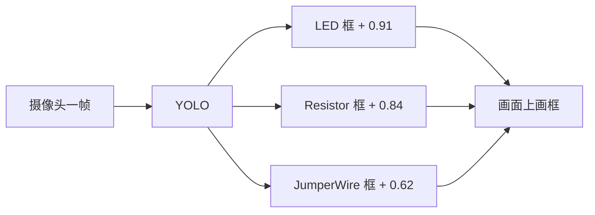
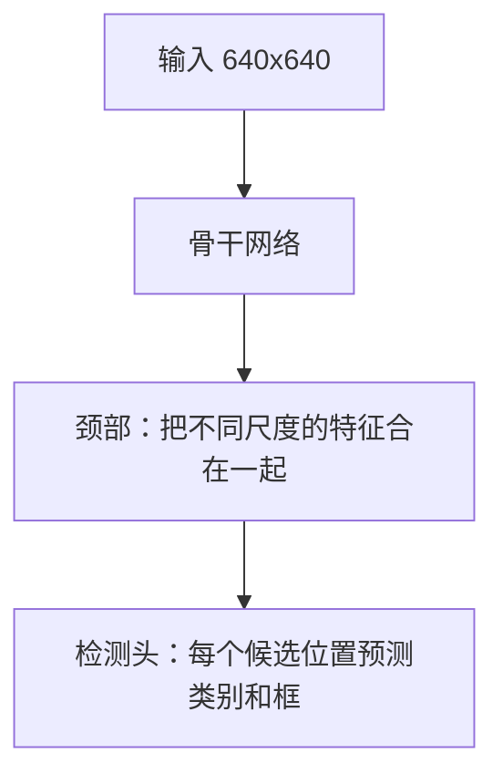
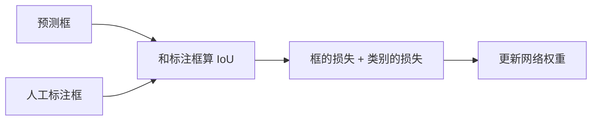
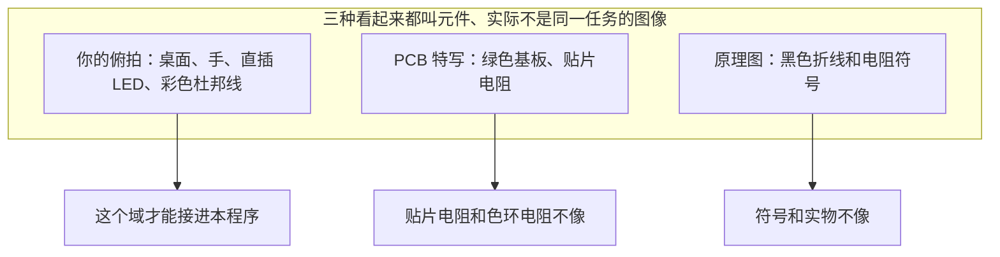
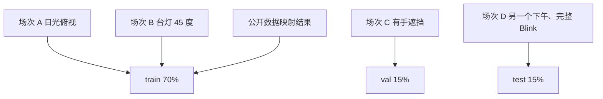
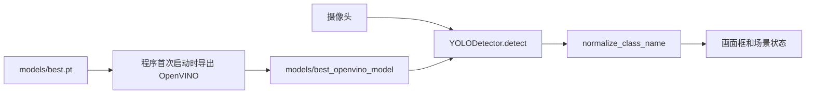

# Phase 2 YOLO 训练方案

本文是一份可以按顺序执行的训练说明，目标是让本程序实时认出面包板上的器件。对应 `plan.md` 第 9 节和第 10 节 Phase 2：

- 训练一个检测模型
- 认出 LED、电阻、杜邦线
- 把权重放到程序已经接好的位置，摄像头画面上实时出框

Phase 2 只回答「画面里有没有这个器件，框在哪里」。它不判断杜邦线插进了哪一孔、连的是不是 D13。那是后续场景图的工作。

查阅日期：2026-09-30。文中的图片数量和类别以当天打开的项目页为准，下载前再看一眼，公开数据集会被作者改版本。

---

## 0. 先看结论

现在仓库里的 `yolov8n.pt` 和 `yolov8n_openvino_model` 是 COCO 预训练模型。它认识人、车、杯子，不认识 LED、电阻、杜邦线。不换权重，Phase 2 不会完成。

公开数据可以当种子，但不能单独当作最终训练集。摄像头高度、灯光、桌面、你手里的 UNO 和面包板，决定了模型在这台程序里好不好用。必须用**程序实际使用的那颗摄像头**再拍一批，和公开数据合在一起训练。

训练结束后只做一件接入的事：把 `best.pt` 复制为 `models/best.pt`。程序会按现有代码把它导出成 640 的 OpenVINO 模型，在 Intel 核显上跑。类别名用第 2 节的六个名字，就不用改检测代码。

建议周期：7 到 10 天。前两天用大约 200 张自己的图加公开种子跑通；再用三到四天补到大约 1200 张；最后两天只补实机失败的样本。

---

## 1. 原理：模型在学什么

### 1.1 检测和分类不是一回事

分类模型看整张图，输出一个类别。检测模型要同时给出类别和位置。本程序要的是检测：每个器件一个框。



程序里的结果结构就是这三样东西：`type`、`bbox`、`confidence`。`bbox` 是左上角和右下角的像素坐标。

### 1.2 为什么 COCO 权重没用，但仍然要下载它

YOLO 可以分成两段：



- 骨干网络在 COCO 上学会了边缘、颜色、纹理。这些对电阻色环、LED 灯珠仍然有用。
- 检测头的类别表是 COCO 的 80 类。里面没有我们的器件。

所以 `yolo11n.pt` 或 `yolov8n.pt` 只作为**初始化**。训练会重写检测头，并继续调整骨干网络。这个过程叫迁移学习。训完之后，权重文件里的类别名必须变成我们自己的六类，而不是 person、cup。

### 1.3 一张图如何变成训练标签

YOLO 检测标签是纯文本。每张图对应一个同名 `.txt`。每一行是一个物体：

```text
class_id  x_center  y_center  width  height
```

五个数里，后四个都是相对图片宽高的比例，范围 0 到 1。`class_id` 从 0 开始。

```text
一张 1000x800 的图里，LED 的像素框是 x1=100, y1=200, x2=180, y2=360

中心 x = (100+180)/2 / 1000 = 0.140
中心 y = (200+360)/2 / 800  = 0.350
宽     = (180-100) / 1000   = 0.080
高     = (360-200) / 800    = 0.200

写入标签文件的一行：
2 0.140000 0.350000 0.080000 0.200000
```

这里的 `2` 是下面类别表里的 LED。

训练时，模型预测的框和这行标签比两件事：

- 框叠得准不准，用 IoU（交并比）。两个框的交集面积除以并集面积，1 是完全重合。
- 类别对不对。



mAP50 是验证集上的综合分数：IoU 达到 0.5 算这个框命中，再按类别算平均精度。它是训练日志里的主要参考，但**不能代替实机测试**。相邻视频帧如果同时出现在训练集和验证集，mAP 会很高，换一个下午的光线就失效。

召回率回答「在的物体有没有被找到」。精确率回答「报出来的框里有多少是真的」。Phase 2 更在意召回：器件在板上却没框出来，后面的步骤判断会以为这一步还没做。

### 1.4 为什么跳线最难

LED 和电阻是小块状物体，正框能包住它们。杜邦线又细又斜。正框会带进大量桌面背景：

```text
俯视图（示意，不是真实比例）

面包板
+----------------------------------+
|                                  |
|     [LED]====红线====            |
|        |                         |
|        | 电阻                     |
|        |                         |
|     ===黑线================      |
|                                  |
+----------------------------------+

LED、电阻：框紧贴物体，背景很少。
斜着的红线：正框里大半是空板。
模型要在「框里大部分不是线」的情况下仍把这一类认成 JumperWire。
```

这不是标错。检测任务里细长斜线本来就这样。Phase 2 接受「框住这根线的大致范围」。如果以后要沿导线画箭头，那是叠加层和场景图的事，不要在这一阶段改成旋转框或分割。程序现在读的是正框，见 `src/vision/detector.py` 里的 `xyxy`。

细线还有第二个问题。程序导出和推理的边长是 **640**。一根在 1080p 画面里只有 4 像素粗的线，缩到 640 后会接近消失。拍摄时要让面包板占画面大约一半以上，让线在缩小之后仍然看得到。

### 1.5 为什么别人的模型不能直接替换



模型记住的是像素样子，不是「电阻」这个词。原理图模型、PCB 模型即使类别名字一样，也不要混进训练集，更不要拿来当 `models/best.pt`。

---

## 2. 和本程序的契约

训练可以换电脑，接入方式不要变。

| 项目 | 必须遵守的值 | 原因 |
|------|----------------|------|
| 权重路径 | `models/best.pt` | `config/settings.py` 的默认 `YOLO_MODEL_PATH` |
| 任务 | 检测，不是分割，不是旋转框 | 检测器只读正框 |
| 输入边长 | 640 | 导出代码把 `imgsz` 固定为 640 |
| 类别名 | 下表六个字符串 | `src/vision/component_db.py` 用它们做规范化 |
| 置信度 | 评估时用 0.35 | `detect()` 的默认阈值 |

类别表。`class_id` 一旦写进 `components.yaml` 就不要再改顺序。

| id | 写入 yaml 和标注工具的名字 | 画面上的中文 | Phase 2 |
|----|------------------------------|--------------|---------|
| 0 | `ArduinoUNO` | Arduino UNO | 建议一起训。大物体，后面步骤也要用 |
| 1 | `Breadboard` | 面包板 | 同上 |
| 2 | `LED` | LED | 必须 |
| 3 | `Resistor` | 电阻 | 必须 |
| 4 | `JumperWire` | 杜邦线 | 必须，也是最难的一类 |
| 5 | `Button` | 按键 | 建议现在就加。以后再加一类要重训检测头 |

`led`、`wire`、`jumper_wires`、`Arduino_uno` 这类别名程序也能认。公开数据映射成上表的正式名字，避免以后对不齐。

不要训练的东西：电阻阻值、LED 颜色、杜邦线颜色、孔位、是否插紧。颜色只作为拍摄时要覆盖的变化，不作为类别。否则红线会被学成 LED。

---

## 3. 公开数据：有什么、怎么用、不要用什么

没有一份现成的 `.pt` 可以拷进 `models/best.pt` 就在这台摄像头上稳定完成 Phase 2。下面是 2026-09-30 能打开的公开数据集。Roboflow 上的项目需要免费账号。导出格式选 **YOLOv8**。页面 Cite 区域写了 License 才按该许可使用；没写 License 就视为作者保留权利，不要默认可以再发布。使用 CC BY 4.0 的数据时，在仓库里留一份来源说明即可。

Roboflow 导出会自带 `data.yaml`、`train/`、`valid/`。那个划分是对方的，不是你的。合并之后要按第 7 节重新按拍摄场次划分。

### 3.1 值得下载、改类名后并入训练集

这些是面包板或实验台实物照片，类别和 Phase 2 有重叠。

| 数据集 | 链接 | 规模与类别 | 怎么用 |
|--------|------|------------|--------|
| Resistor Detection，Circuits Project | https://universe.roboflow.com/circuits-project/resistor-detection-5azes | 756 张。`resistor`、`wire`、`breadboard`。作者写明是面包板实拍，用来判断简单电路 | 最贴近本任务的种子。`wire` 映射为 `JumperWire`。没有 LED、UNO、按键 |
| Circuit Components Detection，CV Laboratory | https://universe.roboflow.com/cv-laboratory/circuit-components-detection-7gniu | 项目页当前约 1400 张。类别 `Resistor`、`Arduino_uno`、`breadboard`、`Led`、`Potentiometer`。页面上的已训练模型是 RF-DETR，不是 Ultralytics 的 `.pt` | 下载数据集，不要下载那个托管模型。丢掉电位器。没有跳线 |
| yolov8_TL，IIT Hyderabad | https://universe.roboflow.com/iit-hyderabad-zvrsg/yolov8_tl | 542 张。`battery`、`arduino`、`breadboard`、`dc_motor`、`jumper_wires`，另有第 6 类（页面标签里还有 `servo_motor`） | 用来补跳线和板子。丢掉电池、电机、舵机。页面 mAP50 为 99.5%，对 542 张图不可信，不要把这个分数当成你的目标 |
| Arduino，Charles Dominique Bacanto | 作者页 https://universe.roboflow.com/charles-dominique-bacanto-sk3id ，项目名 Arduino | 844 张，1 个模型。检索摘要中的类别包括 Arduino、Breadboard、Button、Jumper-Wires、LED、Resistor，以及电容、芯片、万用表、三极管 | 类别最齐的一份。打开项目页核对类别和许可证后再下。电容、芯片、万用表、三极管丢掉 |
| SAMv2 Ardunio | https://universe.roboflow.com/arjunjainstanford/samv2-ardunio | 约 3100 张，实例分割。`resistor`、`ARDUINO`、`Bboard`、`LED`、`line-structure`。2026-09-30 页面上 Dataset versions 为 0 | 分割多边形可以转成正框，但 `line-structure` 可能是面包板内部连线示意，不一定是杜邦线。版本数为 0 时往往还不能导出 YOLO zip。先看几张预览再决定下不下载 |

映射表：

| 公开标签 | 变成 |
|----------|------|
| `arduino`、`Arduino`、`Arduino_uno`、`ARDUINO`、`uno` | `ArduinoUNO` |
| `breadboard`、`Bboard` | `Breadboard` |
| `led`、`Led`、`LED` | `LED` |
| `resistor`、`Resistor` | `Resistor` |
| `wire`、`jumper`、`jumper_wires`、`Jumper-Wires`、`Jumper cables` | `JumperWire` |
| `button`、`Button` | `Button` |
| 电位器、电池、电机、舵机、电容、芯片、万用表、三极管、`line-structure` | 删除该行 |

`line-structure` 先删除。只有你打开图片、确认它框的是杜邦线而不是板子上的印刷线，才映射成 `JumperWire`。

### 3.2 可以搜索、但要先看预览

Roboflow 上还有一批更小或更杂的项目。用这两个入口自己筛，不要把搜索结果整包合并：

- 面包板：https://universe.roboflow.com/search?q=class%3Abreadboard
- 带训练模型的面包板项目：https://universe.roboflow.com/search?q=class%3Abreadboard+trained+model

只收同时满足这三条的图：拍的是实物而不是原理图；能看清直插 LED 或色环电阻或杜邦线；一张图里的无关类可以删掉。少于 100 张的项目对训练帮助很小，可以跳过。

### 3.3 不要当训练集，也不要当 best.pt

| 资源 | 链接 | 为什么不用 |
|------|------|------------|
| 本仓库 COCO 模型 | `yolov8n.pt`、`yolov8n_openvino_model` | 80 类日用物体。只用来初始化骨干网络 |
| AITEE | https://github.com/CKnievel/aitee-dataset | 电路原理图。仓库里的 `nano.pt` 等权认识的是符号和节点 |
| circuitry | https://github.com/tan-thombare/circuitry | 原理图上的元件符号 |
| ci2n jumper | https://github.com/LAD021/ci2n_datasets | 图纸上的连线，标注还是旋转框 |
| pcb2 | https://universe.roboflow.com/na-wa2vi/pcb2-4kcep | PCB 贴片。许可证为 CC BY 4.0，域仍然不对 |
| LibreYOLO circuit-elements | https://huggingface.co/datasets/LibreYOLO/circuit-elements | Roboflow 100 里的电路元件集，主体是 PCB 特写，还有重复、拼写错误的类名 |
| Roboflow 托管推理 API | 各项目页上的 `inference-sdk` 示例 | 走网络，不是本程序的 OpenVINO 本地推理，也不能离线实时画框 |

Combined255 一类「Arduino + 面包板 + LED」资料常见于教程仓库，数据放在网盘，且偏分割。没有稳定的公开权重下载时，不要把它算进计划。

### 3.4 下载步骤

1. 注册 Roboflow，在账号设置里复制 API Key。不要把 Key 写进仓库。
2. 打开第 3.1 节的项目，点 Dataset，再点 Download Dataset。
3. 格式选 YOLOv8，下载 zip。增强选项选 **无** 或尽量少。增强放到我们自己的训练命令里做，避免同一张图的增强副本泄漏到验证集。
4. 解压到 `dataset/external/<短名>/`，例如 `dataset/external/circuits-resistor/`。
5. 每个项目看 20 张图。确认是实物、框没有大面积标错，再进入下一步映射。
6. 页面上的 License 抄到 `dataset/external/SOURCES.md`，写上项目名、URL、访问日期。

PowerShell 下载权重和安装包时走项目代理：

```powershell
$env:HTTP_PROXY="http://10.158.100.9:8080"
$env:HTTPS_PROXY="http://10.158.100.9:8080"
$env:http_proxy="http://10.158.100.9:8080"
$env:https_proxy="http://10.158.100.9:8080"
pip install ultralytics
```

---

## 4. 自己的数据才是 Phase 2 的主体

### 4.1 数量

按「框」算，不按「图片」算。一张 Blink 电路里通常有 1 个 UNO、1 块板、1 个 LED、1 个电阻、3 到 4 根线。

| 阶段 | 自己拍摄的图片 | 作用 |
|------|----------------|------|
| 试点 | 约 200 | 跑通标注、训练、接入，看错在哪里 |
| Phase 2 可用 | 约 1200 | 达到第 11 节的实机标准 |
| 计划上限 | 1000 到 3000 | `plan.md` 的范围。1200 张不够再补，不必一次拍满 |

1200 张自己的图，加上第 3.1 节的种子，实例数大致应达到：LED 不少于约 1500 个框，电阻不少于约 1500 个框，杜邦线不少于约 3000 个框。公开数据里的框可以计入，但自己摄像头的框至少要占每一类的一半。否则模型会偏向别人的背景。

### 4.2 拍摄清单

用程序里的那颗摄像头，也就是 `CAMERA_INDEX` 对应的设备。分辨率至少 1280×720。镜头俯视，面包板占画面宽度大约 50% 到 80%。

每一行都要拍到。用文件夹名记下场次，例如 `raw/session_20261001_desk_daylight/`。

| 变化 | 至少覆盖 |
|------|----------|
| 角度 | 接近垂直俯视；大约 45 度 |
| 光线 | 日光；台灯；顶灯；光从一侧来、另一侧有影子 |
| 桌面 | 木头；浅色桌面；旁边有笔、USB 线、笔记本边缘 |
| 手 | 大约 30% 的图里有手，包括挡住器件一半的情况 |
| 空场景 | 大约 10% 只有桌面、手或 USB 线，板上没有目标器件 |
| LED | 红、绿、黄、蓝；插在板上；放在桌面上还没插 |
| 电阻 | 不同色环；平躺；竖着插 |
| 杜邦线 | 红、黑、黄、蓝、绿、白、橙；横、竖、斜；两根交叉；一头插入、一头悬空 |
| 电路状态 | 空板加 UNO；只有 LED；LED 加电阻；完整 Blink；按键电路；故意插错 |
| 距离 | 板子约占画面 50%、70%、80% 各一批。不要拍成整个房间，也不要只拍一个电阻充满画面 |

USB 线和电源线必须出现在负样本或「只标真实杜邦线」的图里。否则模型会把任何黑色电缆都叫成杜邦线。

### 4.3 从视频抽帧

连续帧几乎是同一张图。全部放进训练集会让验证分数失真。

1. 每个场次录 20 到 40 秒，中间移动一下手或改一下插线。
2. 按大约 2 帧每秒抽出图片。
3. 肉眼删掉糊掉的、板子跑出画面的。
4. 同一场次的图片以后只能全部进训练，或全部进验证，或全部进测试。不能拆开。

ffmpeg 示例，把路径换成该场次的视频：

```powershell
ffmpeg -i session.mp4 -vf fps=2 raw/session_20261001_desk_daylight/frame_%04d.jpg
```

---

## 5. 标注规则

工具用 CVAT、Label Studio 或 Roboflow 都可以。导出 YOLO 检测 txt。类别名用第 2 节的六个字符串，顺序与 id 一致。

```text
标 LED：框住灯珠和两只金属脚。不要把接到脚上的杜邦线框进去。

     +--------+
     |  灯珠  |
     |  /  \  |
     +--------+
        |  |
        |  |   <- 脚可以包含在框内

标电阻：框住电阻体和色环。不同阻值都是 Resistor。

     +------------------+
     | 棕黑红金 ...... |
     +------------------+

标杜邦线：一根线一个框，框有颜色的塑料线身。针脚可以算在这根线里，不要单独成类。
斜线、弯线用正框，允许框里有很多空板。

标 UNO、面包板：整块一个框。被手挡住时，按还能看见的外形框，不要猜被挡住的部分扩很大。

标按键：四只脚的按键整体一个框。

不标：挡住超过大约 70%、只剩一只脚的器件；短于大约 40 像素的线头。
```

标完一个场次后，换一个人或换一个时间再看 10% 的图，专门查这三件事：LED 和电阻有没有标反；红线有没有被标成 LED；USB 线有没有被标成杜邦线。

---

## 6. 把公开标签改成我们的六类

在仓库里新建 `tools/remap_yolo_labels.py`，内容如下。它读一个已经是 YOLO txt 的目录，按第 3.1 节的表改写类别，并丢掉不要的类。

```python
"""把外部 YOLO 标签改写成 Phase 2 的六个类别。"""

from __future__ import annotations

import shutil
import sys
from pathlib import Path

import yaml

CANON = ["ArduinoUNO", "Breadboard", "LED", "Resistor", "JumperWire", "Button"]
INDEX = {name: i for i, name in enumerate(CANON)}

ALIASES = {
    "arduino": "ArduinoUNO",
    "arduino_uno": "ArduinoUNO",
    "arduino-uno": "ArduinoUNO",
    "uno": "ArduinoUNO",
    "breadboard": "Breadboard",
    "bboard": "Breadboard",
    "led": "LED",
    "resistor": "Resistor",
    "wire": "JumperWire",
    "jumper": "JumperWire",
    "jumper_wire": "JumperWire",
    "jumper_wires": "JumperWire",
    "jumper-wires": "JumperWire",
    "jumper_cables": "JumperWire",
    "button": "Button",
    "push_button": "Button",
}


def canon_name(raw: str) -> str | None:
    key = raw.strip().lower().replace(" ", "_")
    if key in ALIASES:
        return ALIASES[key]
    if raw in INDEX:
        return raw
    return None


def load_names(data_yaml: Path) -> dict[int, str]:
    data = yaml.safe_load(data_yaml.read_text(encoding="utf-8"))
    names = data["names"]
    if isinstance(names, dict):
        return {int(k): str(v) for k, v in names.items()}
    return {i: str(v) for i, v in enumerate(names)}


def remap_split(src: Path, dst: Path, names: dict[int, str]) -> tuple[int, int]:
    kept = dropped = 0
    images = src / "images"
    labels = src / "labels"
    if not images.is_dir():
        return 0, 0
    for image in images.iterdir():
        if image.suffix.lower() not in {".jpg", ".jpeg", ".png", ".bmp", ".webp"}:
            continue
        label = labels / f"{image.stem}.txt"
        lines_out: list[str] = []
        if label.is_file():
            for line in label.read_text(encoding="utf-8").splitlines():
                parts = line.split()
                if len(parts) < 5:
                    continue
                raw = names.get(int(float(parts[0])), "")
                mapped = canon_name(raw)
                if mapped is None:
                    dropped += 1
                    continue
                parts[0] = str(INDEX[mapped])
                lines_out.append(" ".join(parts[:5]))
                kept += 1
        if not lines_out:
            continue
        (dst / "images").mkdir(parents=True, exist_ok=True)
        (dst / "labels").mkdir(parents=True, exist_ok=True)
        shutil.copy2(image, dst / "images" / image.name)
        (dst / "labels" / f"{image.stem}.txt").write_text(
            "\n".join(lines_out) + "\n", encoding="utf-8"
        )
    return kept, dropped


def main() -> None:
    src_root = Path(sys.argv[1])
    dst_root = Path(sys.argv[2])
    yaml_path = next(src_root.rglob("data.yaml"))
    names = load_names(yaml_path)
    total_kept = total_dropped = 0
    for split in ("train", "valid", "val", "test"):
        kept, dropped = remap_split(src_root / split, dst_root / "all", names)
        total_kept += kept
        total_dropped += dropped
    print(f"kept={total_kept} dropped={total_dropped} -> {dst_root / 'all'}")


if __name__ == "__main__":
    main()
```

用法：

```powershell
pip install pyyaml
python tools/remap_yolo_labels.py dataset/external/circuits-resistor dataset/external/circuits-resistor-canon
```

对每一个外部数据源跑一次。输出目录里的 `all/images` 和 `all/labels` 是映射后的图。然后各抽 30 张，用下面的检查脚本画框看一眼。

---

## 7. 目录和划分

最终训练目录：

```text
dataset/
  components.yaml
  external/
    SOURCES.md
    circuits-resistor/          原始下载
    circuits-resistor-canon/    映射之后
  raw/
    session_20261001_desk_daylight/
  images/
    train/
    val/
    test/
  labels/
    train/
    val/
    test/
```

`dataset/components.yaml`：

```yaml
path: C:/media/workspace/ai_ardunio/dataset
train: images/train
val: images/val
test: images/test
nc: 6
names:
  0: ArduinoUNO
  1: Breadboard
  2: LED
  3: Resistor
  4: JumperWire
  5: Button
```

`path` 用你机器上的绝对路径。

划分比例大约是 70% 训练、15% 验证、15% 测试。单位是**场次**，不是图片。自己拍的测试集必须来自程序那颗摄像头，而且这些场次没有参与训练。公开数据全部放进训练，或单独留一小部分做参考；不要用公开数据的测试集代替实机验收。



复制文件时，图片和同名 txt 必须进同一个 split。没有目标的负样本也要复制，并配一个空的 txt。

---

## 8. 训练前检查

新建 `tools/preview_labels.py`，确认 id、框和文件名对得上。看完关掉窗口即进入下一步。

```python
"""把 YOLO 标签画回图片上，训练前抽查。"""

from pathlib import Path
import random
import sys

import cv2

NAMES = ["ArduinoUNO", "Breadboard", "LED", "Resistor", "JumperWire", "Button"]


def draw(image_path: Path, label_path: Path) -> None:
    image = cv2.imread(str(image_path))
    if image is None:
        return
    h, w = image.shape[:2]
    if label_path.is_file():
        for line in label_path.read_text(encoding="utf-8").splitlines():
            parts = line.split()
            if len(parts) < 5:
                continue
            cls_id = int(float(parts[0]))
            cx, cy, bw, bh = map(float, parts[1:5])
            x1 = int((cx - bw / 2) * w)
            y1 = int((cy - bh / 2) * h)
            x2 = int((cx + bw / 2) * w)
            y2 = int((cy + bh / 2) * h)
            cv2.rectangle(image, (x1, y1), (x2, y2), (0, 220, 0), 2)
            cv2.putText(
                image,
                NAMES[cls_id] if 0 <= cls_id < len(NAMES) else str(cls_id),
                (x1, max(20, y1 - 6)),
                cv2.FONT_HERSHEY_SIMPLEX,
                0.6,
                (0, 220, 0),
                2,
            )
    cv2.imshow("preview", image)
    cv2.waitKey(0)


def main() -> None:
    root = Path(sys.argv[1])  # dataset/images/train 的上一级，即含 images 与 labels
    split = sys.argv[2] if len(sys.argv) > 2 else "train"
    images = list((root / "images" / split).glob("*.*"))
    random.shuffle(images)
    for image in images[:30]:
        draw(image, root / "labels" / split / f"{image.stem}.txt")
    cv2.destroyAllWindows()


if __name__ == "__main__":
    main()
```

```powershell
python tools/preview_labels.py dataset train
```

同时统计每一类的框数。某一类少于第 4.1 节的下限，就先补拍，不要开始长训练。

```powershell
python -c "from pathlib import Path; from collections import Counter; c=Counter();
[ c.update(int(float(l.split()[0])) for l in p.read_text().splitlines() if l.strip()) for p in Path('dataset/labels/train').glob('*.txt') ];
print(sorted(c.items()))"
```

输出应是 id 0 到 5 的计数。若出现 6 或更大的 id，说明映射没做完。

---

## 9. 第一轮：200 张试点

这一轮的目的不是刷分，是确认流程能在程序里出框。

有 NVIDIA 显卡就在本机训。只有 Intel 核显时，核显留给程序推理，训练放到 Colab 的 T4 或别的 NVIDIA 机器上。训练数据和 `best.pt` 再拷回本仓库。

```powershell
yolo detect train model=yolo11n.pt data=dataset/components.yaml epochs=80 imgsz=640 batch=16 patience=20 optimizer=AdamW lr0=0.001 device=0 project=runs/detect name=pilot
```

| 参数 | 取值 | 原因 |
|------|------|------|
| `model` | `yolo11n.pt` | 小模型，适合核显实时。Ultralytics 8.4 可以导出成程序用的 OpenVINO。没有 YOLO11 时改成 `yolov8n.pt` |
| `imgsz` | 640 | 与 `detector.py` 导出尺寸一致。训练集用 1280、上线用 640，细线会在导出时丢光 |
| `batch` | 16 | 显存不够就改 8。只有 CPU 时命令里的 `device=0` 改成 `device=cpu`，batch 用 8 |
| `epochs` / `patience` | 80 / 20 | 试点够用。验证分数连续 20 个 epoch 不升就停 |
| `lr0` | 0.001 | 数据量不大时，比默认 0.01 更稳 |

增强用 Ultralytics 默认的 mosaic 即可。上下翻转关掉，面包板的上下方向对后续步骤还有意义；左右翻转可以保留。

```powershell
yolo detect train model=yolo11n.pt data=dataset/components.yaml epochs=80 imgsz=640 batch=16 patience=20 optimizer=AdamW lr0=0.001 flipud=0.0 device=0 project=runs/detect name=pilot
```

训练时看 `runs/detect/pilot/results.png`：

- 框的损失和分类损失总体下降。
- 验证 mAP50 上升后变平。变平就可以停，不必把 epoch 跑满。
- 训练损失继续降、验证 mAP 开始掉，是过拟合。停止，回到补数据，而不是加 epoch。

试点结束的最低要求：在验证集图片上，LED 和电阻大多数能框对，UNO 和面包板稳定，跳线允许漏。然后按第 12 节把 `runs/detect/pilot/weights/best.pt` 暂时拷到 `models/best.pt`，打开程序看真实摄像头。把漏检和误检记下来，它们决定下一轮拍什么。

---

## 10. 第二轮：补到可用

按试点的失败类型补拍，每类失败大约 50 到 100 张，总数到大约 1200 张自己的图。典型失败和补法：

| 实机现象 | 补什么 |
|----------|--------|
| 红杜邦线被标成 LED | 红色的线，旁边没有 LED；以及红 LED 旁边是黑线、黄线 |
| USB 线被标成杜邦线 | 桌上有 USB 线、但只标真正的杜邦线；再加一批只有 USB 线的空 txt |
| 手挡住后电阻消失 | 手从上方、左侧进入，挡住电阻一半 |
| 斜线完全没有框 | 45 度的短线、交叉线、黄线和木桌同色的线 |
| 只在俯视时有效，一歪就丢 | 多拍 45 度，并让板子不在画面正中 |

第二轮从第一轮的 `best.pt` 接着训，而不是从 COCO 重新开始：

```powershell
yolo detect train model=runs/detect/pilot/weights/best.pt data=dataset/components.yaml epochs=60 imgsz=640 batch=16 patience=20 optimizer=AdamW lr0=0.0005 flipud=0.0 device=0 project=runs/detect name=phase2
```

`lr0` 降到 0.0005，避免把已经学会的 LED 和电阻冲掉。

跳线召回仍然明显低于第 11 节时，把模型换成 `yolo11s.pt` 再训一轮。不要直接用 m 或 l。核显上的实时性会变差，而且细线的主要问题通常是数据和拍摄距离，不是模型不够大。

---

## 11. 什么叫 Phase 2 完成

在测试集上算指标。测试集场次没有出现在训练和验证里，并且是程序那颗摄像头拍的。

```powershell
yolo detect val model=runs/detect/phase2/weights/best.pt data=dataset/components.yaml imgsz=640 conf=0.35 split=test
```

| 类 | mAP50 | 物体在场时的召回 |
|----|-------|------------------|
| LED | 不低于 0.85 | 不低于 0.90 |
| Resistor | 不低于 0.80 | 不低于 0.85 |
| JumperWire | 不低于 0.70 | 不低于 0.75 |
| ArduinoUNO、Breadboard | 不低于 0.90 | 不低于 0.95 |

数字只是门槛。还要做三次实机，每次重新摆一个 Blink：

1. 只插 LED 和电阻，不插线。两个器件有框，拔掉后框消失。
2. 接上 3 到 4 根杜邦线。至少框中其中两根。USB 线、笔、手指不要稳定地被当成杜邦线。
3. 手在板上停留大约十秒。手拿开后，原来的器件还在。

三次里允许跳线漏一根。LED 或电阻整次失踪，就不算完成，回到第 10 节补数据。

---

## 12. 接回程序

```powershell
New-Item -ItemType Directory -Force models | Out-Null
Copy-Item runs/detect/phase2/weights/best.pt models/best.pt
```

启动程序。检测器发现 `models/best.pt` 后，会在同目录生成 `models/best_openvino_model`，首次导出比较慢。原来的 `yolov8n_openvino_model` 是 COCO 占位，不会走这条路径。

确认两件事：

- 日志里不再出现 `using yolov8n (COCO) placeholder`。
- 画面标签是 LED、电阻、杜邦线，不是 person、cup、bottle。

若标签仍是 COCO 的物体，说明加载的还是占位权重：检查 `models/best.pt` 是否在项目根下，或 `.env` 里的 `YOLO_MODEL_PATH` 是否指向别处。



---

## 13. 执行清单

按顺序打勾。不要跳过试点直接拍 3000 张。

1. 安装 Ultralytics，确认能下载 `yolo11n.pt`。下载走第 3.4 节的代理。
2. 写好 `dataset/components.yaml`，六个类的顺序与第 2 节一致。
3. 从第 3.1 节选两到三份数据集下载，格式 YOLOv8，不做或少做网站上的增强。
4. 每份看 20 张预览。原理图和 PCB 特写整份丢弃。
5. 记录许可证到 `dataset/external/SOURCES.md`。
6. 运行映射脚本，抽 30 张画框检查。
7. 用程序摄像头拍试点场次，约 200 张，文件夹名带日期和光线。
8. 标注，并复查 10%。
9. 按场次划出 train、val、test。公开数据进 train。
10. 统计六个 id 的框数，确认没有 id 大于 5。
11. 跑试点训练 `name=pilot`。
12. 把试点 `best.pt` 放进 `models/best.pt`，在程序里看真实画面，记下失败类型。
13. 按失败类型补拍到约 1200 张自己的图，从试点权重继续训 `name=phase2`。
14. 用 `conf=0.35` 在 test 上评估，并做三次 Blink 实机。
15. 通过第 11 节后，保留最终的 `models/best.pt`。未通过就只补失败样本，再训 40 到 60 个 epoch。

---

## 14. 常见偏差

训练日志 mAP 很高，实机很差。验证集和训练集来自同一段视频的相邻帧。按场次重新划分。

只有俯视、白桌面、没有手的图能检出。补 45 度、其他灯光，以及大约 30% 带手的图。

红线总被认成 LED。增加「红线且画面里没有 LED」的图，并检查旧标注里有没有把线标成 LED。

导出之后细线全部消失。训练 `imgsz` 不是 640，或者拍摄时板子在画面里太小。两项都要改，只改模型大小没用。

公开数据越多分数越高，自己的摄像头越差。自己的框不到该类的一半。减少外部数据比例，或继续拍自己的场次。
