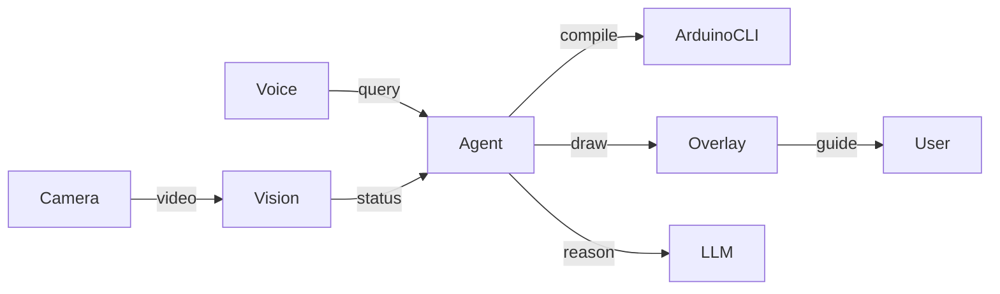

# Arduino AI Learning Copilot MVP 实施方案

## 1. 项目目标

构建一个桌面版 Arduino AI Agent，集成：

- Arduino CLI 自动编译与烧录
- 摄像头实时识别硬件状态
- YOLO 器件识别
- OpenCV AR 叠加标注
- 语音交互
- 手势交互
- LLM 推理指导
- 项目步骤跟踪

目标体验：

用户一边搭建电路，一边通过语音询问：

> 当前组装到哪一步？
>
> 下一步怎么接？
>
> 为什么烧录失败？

Agent 实时分析摄像头画面，并在视频中自动用箭头、框和高亮指导用户。

---

# 2. MVP 范围

第一阶段只支持：

- Arduino UNO
- Breadboard
- LED
- 电阻
- 杜邦线

实验项目：

- Blink LED
- Button + LED

MVP 成功标准：

- 自动识别器件
- 自动判断当前步骤
- 自动给出下一步指导
- 编译烧录代码
- 视频实时标注
- 语音问答

---

# 3. 技术架构



---

# 4. 系统模块

## Module 1 Arduino Manager

职责：

- Board检测
- 串口检测
- Compile
- Upload
- Monitor

目录：

```text
src/arduino/
├── board_manager.py
├── compile_manager.py
├── upload_manager.py
└── serial_monitor.py
```

封装：

```python
compile_project()
upload_firmware()
list_boards()
open_monitor()
```

调用：

```bash
arduino-cli board list
arduino-cli compile
arduino-cli upload
```

---

## Module 2 Vision System

目录：

```text
src/vision/
├── detector.py
├── tracker.py
├── scene_parser.py
└── component_db.py
```

YOLO识别：

- Arduino UNO
- Breadboard
- LED
- Resistor
- Jumper Wire

输出：

```json
{
  "type":"LED",
  "bbox":[100,50,200,160],
  "confidence":0.95
}
```

---

## Module 3 Scene Graph

维护实时硬件拓扑。

模型：

```json
{
 "led1":{
  "connected_to":"D13"
 },
 "resistor1":{
  "connected_to":"led1"
 }
}
```

功能：

- 判断器件是否存在
- 分析连接情况
- 判断步骤完成度

---

## Module 4 Overlay Engine

基于 OpenCV。

功能：

- 方框标注
- 箭头指导
- 高亮目标
- 连接路径提示

接口：

```python
show_bbox()
draw_arrow()
highlight_target()
```

示例：

```text
LED
 ↑
 │
 └── Connect to D13
```

---

## Module 5 Voice Assistant

建议：

- Faster Whisper
- OpenAI Realtime

流程：

```text
Mic
↓
ASR
↓
Intent
↓
Agent
```

支持：

- 当前状态
- 下一步
- 解释代码
- 烧录程序

---

## Module 6 Gesture Control

采用 MediaPipe。

手势定义：

- ThumbUp = 下一步
- Palm = 暂停
- Victory = 重新识别

---

## Module 7 LLM Agent

建议模型：

- GPT-5
- GPT-4o
- Qwen3

工具注册：

```python
vision_tool
arduino_tool
project_tool
voice_tool
```

Agent策略：

```text
感知
↓
分析
↓
规划
↓
执行
```

---

# 5. 项目状态机

示例 Blink 项目。

```json
{
 "step1":"insert_led",
 "step2":"insert_resistor",
 "step3":"connect_d13",
 "step4":"connect_gnd",
 "step5":"upload"
}
```

状态判断：

```python
current_step()
next_step()
verify_step()
```

---

# 6. 软件架构

```text
src
├── main.py
├── ui
├── vision
├── agent
├── overlay
├── voice
├── gesture
├── arduino
├── project
└── config
```

---

# 7. UI设计

PySide6。

区域：

```text
+--------------------------------+
| Camera View                    |
|                                |
| Bounding Boxes                 |
+--------------------------------+
| Current Step                   |
+--------------------------------+
| Chat Window                    |
+--------------------------------+
| Upload Monitor                 |
+--------------------------------+
```

---

# 8. 数据库设计

SQLite。

表：

```sql
projects
components
steps
history
```

---

# 9. 训练数据

目录：

```text
dataset
├── images
├── labels
└── yaml
```

首批数据：

- Arduino UNO
- Breadboard
- LED
- Button
- Resistor

目标：

1000~3000标注图片。

---

# 10. Cursor Plan Mode 分阶段实施

## Phase 1 基础框架

- PySide6窗口
- Camera显示
- Arduino CLI集成
- 项目结构初始化

交付：

可看到摄像头画面并检测开发板。

## Phase 2 YOLO识别

- 训练模型
- 识别LED
- 识别电阻
- 识别跳线

交付：

实时检测器件。

## Phase 3 Overlay

- 方框
- 箭头
- 标签

交付：

实现视觉指导。

## Phase 4 Agent

- 项目状态机
- Tool Calling
- 步骤判断

交付：

能够回答下一步。

## Phase 5 Voice

- Whisper
- TTS

交付：

语音交互。

## Phase 6 Gesture

- MediaPipe
- 手势映射

交付：

手势控制。

---

# 11. 推荐依赖

```bash
pip install pyside6
pip install opencv-python
pip install ultralytics
pip install mediapipe
pip install faster-whisper
pip install openai
pip install pydantic
pip install sqlalchemy
```

---

# 12. 长期演进路线

V1

- LED实验
- Button实验

V2

- OLED
- Servo
- DHT11

V3

- 自动接线检查
- 自动故障分析
- 自动生成代码

V4

- ESP32
- STM32
- Raspberry Pi

最终形成：

Arduino Copilot Desktop

= Arduino IDE + AI Agent + Vision + Voice + AR Guidance
